[🏠 Trang chủ Docs](../README.md) > [Giai đoạn 1: Khai phá & Kế hoạch](./README.md) > **00_tong_quan_proposal.md**

---

# TỔNG QUAN HỒ SƠ ĐỀ XUẤT BÀI TẬP LỚN CNPM - TEAM 13
## Hệ thống Quản lý Thu phí và Dân cư Chung cư BlueMoon (BMS / BFMS)

---

## 1. Thông tin Nhóm và Đề tài
- **Tên môn học:** Công nghệ phần mềm (IT3180) - Học kỳ 2026.1
- **Nhóm thực hiện:** **Team 13**
- **Đề tài:** Phần mềm Quản lý Thu các loại phí tại Chung cư BlueMoon
- **Khách hàng thụ hưởng:** Ban Quản trị Chung cư BlueMoon (Ngã tư Văn Phú, quận Hà Đông, TP. Hà Nội)
- **Quy mô tòa nhà:** $450\text{ m}^2$, 30 tầng nổi (1 tầng ki-ốt, 4 tầng đế kinh doanh, 24 tầng căn hộ ở, 1 tầng penthouse).
- **Thành viên nhóm & Phân công vai trò:**
  - **Khánh (TV1):** Business Analysis Lead (Chủ trì Scope, SMART, MoSCoW Backlog)
  - **Hoà (TV2):** System Analysis (Chủ trì Hộ khẩu, Nhân khẩu, Biến động cư trú)
  - **Đức Anh (TV3):** UX/UI Designer (Chủ trì Thiết kế Wireframes / Prototype Figma)
  - **Sơn (TV4):** Data Engineer (Chủ trì Phân tích Quỹ tự nguyện, Khảo sát cư dân, CSDL)
  - **Huy (TV5):** QA Specialist (Chủ trì NFR Checklist, Acceptance Criteria GWT, Traceability Matrix)

---

## 2. Kiến trúc Tổng thể Hồ sơ Khai phá Yêu cầu (Elicitation Framework)

```mermaid
flowchart TD
    subgraph Sources["Nguồn thu thập thực tế"]
        S1["Phỏng vấn Ban Quản trị & Kế toán"]
        S2["Khảo sát cư dân qua Google Forms (CNPM_TV4_Analysis)"]
        S3["Quan sát sổ tay thu quỹ viết tay phường Khương Đình (Hình 1-1)"]
        S4["Văn bản pháp lý (Luật Cư trú 2020, TT 02/2016/TT-BXD, NĐ 93/2021)"]
    end

    subgraph RawFindings["Tầng Kết quả Thô (Raw Findings)"]
        R1["Client's Wish List: 32 RAW Items (RAW-001 -> RAW-032)"]
        R2["As-Is Scenario Map & Bảng phân tích 5 Pain Points"]
        R3["To-Be Scenario Map (Số hóa quy trình vận hành)"]
        R4["Raw NFR Checklist: NFR-01 -> NFR-05 (Metrics định lượng)"]
    end

    subgraph ScrumLayer["Tầng Chuẩn hóa Scrum (Scrum Artefacts)"]
        SC1["User Story Map: 6 Epics lớn (Trích xuất từ Shape Sheet)"]
        SC2["Bộ 11 User Stories chuẩn INVEST (US-001 -> US-011)"]
        SC3["Bộ Acceptance Criteria chuẩn Given-When-Then & Definition of Done"]
    end

    subgraph Management["Tầng Quản lý & Thẩm định"]
        M1["Product Backlog phân loại MoSCoW & Kế hoạch Sprint"]
        M2["Conflict Resolution Note: Tách bạch Mục A (Bắt buộc) & Mục B (Tùy tâm)"]
        M3["Risk Log: Kiểm soát rủi ro sai lệch dữ liệu Excel cũ"]
        M4["Traceability Matrix: Ánh xạ 100% RAW -> Epic -> Feature -> US -> AC"]
    end

    Sources --> RawFindings
    RawFindings --> ScrumLayer
    ScrumLayer --> Management
```

---

## 3. Bản đồ Điều hướng Hồ sơ Markdown

1. [`01_phac_thao_va_ke_hoach_phan_cong.md`](./01_phac_thao_va_ke_hoach_phan_cong.md): 5 bước khai phá yêu cầu và bảng kế hoạch phân công 5 thành viên trong 6 ngày.
2. [`02_ke_hoach_chi_tiet_khai_pha.md`](./02_ke_hoach_chi_tiet_khai_pha.md): Kế hoạch chi tiết khai phá yêu cầu, bối cảnh, bài toán thu phí $m^2$, phương pháp JAD Workshop, ma trận MoSCoW và 9 deliverables.
3. [`03_tuyen_ngon_du_an.md`](./03_tuyen_ngon_du_an.md): Tài liệu Tuyên ngôn dự án hoàn chỉnh (Mã `PRJ-BLUEMOON-2026`, Scope Statement In/Out-Scope, Ma trận Stakeholders Power/Interest Grid, 8 mục tiêu SMART `OBJ-01` $\rightarrow$ `OBJ-08`, Kịch bản phỏng vấn).
4. [`04_ke_hoach_du_an_va_user_story_map.md`](./04_ke_hoach_du_an_va_user_story_map.md): Kế hoạch tiến độ và toàn bộ **Epic-Focused User Story Map** được đọc từ các khối text shape trong Google Sheet `CNPM_Team13_Epic-US` (6 Epics, Roles, Goals, Stories, Tasks, AC, Priority, Release Phase).
5. [`05_chi_tiet_us_va_acceptance_criteria.md`](./05_chi_tiet_us_va_acceptance_criteria.md): Bảng chi tiết 11 User Stories (`US-001` $\rightarrow$ `US-011`) kèm toàn bộ tiêu chí chấp nhận Acceptance Criteria, Definition of Done, Priority và Story Points từ `CNPM_Team13_US-AC.xlsx`.
6. [`06_client_wishlist_as_is_to_be_nfr.md`](./06_client_wishlist_as_is_to_be_nfr.md): Danh sách 32 mong muốn thô của cư dân và BQT (`RAW-001` $\rightarrow$ `RAW-032`), As-Is Scenario Map kèm các Pain Points, To-Be Scenario Map, và 5 yêu cầu phi chức năng có tiêu chí đo kiểm rõ ràng.
7. [`07_traceability_matrix_va_quan_ly_rui_ro.md`](./07_traceability_matrix_va_quan_ly_rui_ro.md): Ma trận truy vết yêu cầu 5 tầng, Biên bản giải quyết xung đột hóa đơn và Nhật ký quản lý rủi ro dữ liệu Excel cũ.
8. [`08_phu_luc_tuan_thu_phap_ly.md`](./08_phu_luc_tuan_thu_phap_ly.md): Phụ lục yêu cầu tuân thủ Luật Cư trú 2020, Thông tư 02/2016/TT-BXD, Nghị định 93/2021/NĐ-CP và hướng dẫn quản lý hành chính địa phương.
9. [`09_ke_hoach_du_an_chi_tiet.md`](./09_ke_hoach_du_an_chi_tiet.md): [Chuẩn SoICT] Kế hoạch dự án, cấu trúc phân cấp công việc WBS 2 dạng (theo Sản phẩm & theo Scrum 4 Sprints), Ma trận RACI và Biểu đồ tiến độ Gantt Chart.
10. [`10_ke_hoach_quan_ly_rui_ro_toan_dien.md`](./10_ke_hoach_quan_ly_rui_ro_toan_dien.md): [Chuẩn SoICT] Kế hoạch quản lý rủi ro toàn diện, Ma trận Rủi ro 3x3 và Risk Tracking Log.
