# KẾ HOẠCH DỰ ÁN VÀ EPIC-FOCUSED USER STORY MAP
## Dự án: Phần mềm Quản lý Thu phí Chung cư BlueMoon (BMS)
### Tài liệu nguồn: Tab 6 ("Kế hoạch dự án") - Google Docs, Google Sheet `IT3180_BTL_Team13` & Text Shapes trong `CNPM_Team13_Epic-US`

---

## PHẦN 1: KẾ HOẠCH VÀ PHÂN CÔNG NHIỆM VỤ DỰ ÁN (SHEET `IT3180_BTL_Team13`)

### 1.1. Thông tin mốc thời hạn (Deadlines)
- **Tài liệu Yêu cầu BTL:** `CNPM_20261_YcBTL.pdf`
- **Hạn hoàn thiện Epic - US & Use Case & AC:** **21h00 ngày 09/10/2026**
- **Tài liệu Hướng dẫn Report 1:** `CNPM_20261_Huong dan khai pha yc.pdf`
- **Hạn hoàn thiện Báo cáo Khai phá Yêu cầu:** **12h00 ngày 10/10/2026**
- **Báo cáo tham khảo:** `IT3180_Report Tham khảo`

### 1.2. Danh sách phân công nhiệm vụ thành viên Team 13

| Vai trò | Thành viên | Ghi chú tài liệu liên quan | Trạng thái |
|---|---|---|:---:|
| **TV1 - Business Analysis** | **Khánh** | Chủ trì Scope Statement, SMART Goals, MoSCoW Product Backlog | Đang tiến hành |
| **TV2 - System Analysis** | **Hoà** | Chủ trì phân hệ Hộ khẩu, Nhân khẩu, Biến động cư trú (`CNPM_Proposal_Team13`) | Đang tiến hành |
| **TV3 - UX/UI Designer** | **Đức Anh** | Thiết kế Wireframes / Prototype Figma (Dashboard, Thu ngân, Sổ quỹ) | Đang tiến hành |
| **TV4 - Data Engineer** | **Sơn** | Phân tích Quỹ tự nguyện, Khảo sát cư dân, Thiết kế CSDL (`CNPM_TV4_Analysis`) | Đang tiến hành |
| **TV5 - QA Specialist** | **Huy** | Kiểm soát chất lượng, NFR Checklist, Acceptance Criteria (GWT), Traceability | Đang tiến hành |

---

## PHẦN 2: EPIC-FOCUSED USER STORY MAP (TRÍCH XUẤT TỪ TEXT SHAPES GOOGLE SHEET)

Toàn bộ nội dung dưới đây được đọc và trích xuất trực tiếp từ các khối vẽ (shapes/drawings) trong bảng tính `CNPM_Team13_Epic-US`:

```mermaid
graph TD
    subgraph Epics["EPIC-FOCUSED USER STORY MAP - TEAM 13"]
        E0["EPIC 0: Quản trị Hệ thống & Bảo mật"]
        E1["EPIC 1: Quản lý Căn hộ & Chủ hộ"]
        E6["EPIC 6: Quản lý Nhân khẩu & Cư trú"]
        E2["EPIC 2: Biểu phí & Thu phí bắt buộc"]
        E3["EPIC 3: Tra cứu & Thống kê Thu nợ"]
        E4["EPIC 4: Quỹ tự nguyện & Tài chính"]
        E5["EPIC 5: Tiện ích mở rộng tòa nhà (v2.0)"]
    end

    E0 --> USSEC01["US-SEC-01: Quản lý Tài khoản BQT & RBAC"]
    E0 --> USSEC02["US-SEC-02: Xác thực Đăng nhập & Đổi mật khẩu"]

    E1 --> US01["US-001: Thông tin Hộ khẩu & Chủ hộ"]
    E1 --> US04["US-004: Trích xuất Báo cáo Nhân khẩu"]

    E6 --> US02["US-002: Thêm mới & Quản lý Nhân khẩu"]
    E6 --> US03["US-003: Quản lý Trạng thái & Biến động Cư trú"]

    E2 --> US05["US-005: Khởi tạo & Quản lý Biểu phí"]
    E2 --> US06["US-006: Tính phí tự động hàng tháng"]

    E3 --> US07["US-007: Thu tiền, Gạch nợ & In phiếu PDF"]
    E3 --> US11["US-011: Tra cứu Lịch sử & Báo cáo Nợ phí"]

    E4 --> US08["US-008: Tạo đợt vận động quyên góp"]
    E4 --> US09["US-009: Ghi nhận tiền đóng góp & In phiếu"]
    E4 --> US10["US-010: Báo cáo tổng kết & Công khai quỹ"]

    E5 --> R29["RAW-029: Quản lý phí gửi xe máy/ô tô"]
    E5 --> R30["RAW-030: Thu hộ Điện, Nước, Internet"]
    E5 --> R31["RAW-031: Cổng thanh toán VietQR tự động"]
    E5 --> R32["RAW-032: Mobile App / Zalo tra cứu"]
```

---

### CHI TIẾT CÁC EPICS TRONG STORY MAP

#### EPIC 0: Quản trị Hệ thống & Bảo mật (System Administration & Security)
- **Mô tả (Epic Description):** Phân hệ nền tảng quản trị tài khoản người dùng BQT, cấu hình phân quyền theo vai trò (RBAC: Admin, Kế toán, Thủ quỹ, Cư dân), xác thực phiên làm việc an toàn và kiểm soát an ninh truy cập.
- **User Roles:** Quản trị viên (Admin), Kế toán, Thủ quỹ.
- **User Goals:** Khởi tạo, cập nhật trạng thái tài khoản BQT; bảo vệ hệ thống trước tấn công Brute-force qua cơ chế khóa tài khoản tự động sau 5 lần đăng nhập thất bại liên tiếp; hỗ trợ người dùng tự đổi mật khẩu định kỳ.
- **User Stories trực thuộc:**
  - `US-SEC-01`: Quản lý Tài khoản Ban Quản trị & Phân quyền RBAC (`ROLE_ADMIN`, `ROLE_ACCOUNTANT`, `ROLE_CASHIER`). *(Ghi chú lịch sử: tương ứng US-001 trong prompt Sprint 1)*.
  - `US-SEC-02`: Xác thực Người dùng, Đăng nhập hệ thống, Khóa Brute-force và Đổi mật khẩu. *(Ghi chú lịch sử: tương ứng US-002 trong prompt Sprint 1 / US-005 trong WBS cũ / Core Workflow 1 trong AGENTS.md)*.
- **Priority:** **Highest Priority** | **Release Phase:** Sprint 1 Foundation.

---

#### EPIC 1: Quản lý Căn hộ và Chủ hộ
- **Mô tả (Epic Description):** Phân hệ nền tảng giúp quản lý toàn bộ danh mục không gian tòa nhà (Kiot, Thương mại, Căn hộ ở, Penthouse) cùng hệ thống hồ sơ pháp lý gắn kết chủ hộ đại diện cho từng căn hộ.
- **User Roles:** Ban quản trị (BQT), Kế toán.
- **User Goals:** Thiết lập dữ liệu chuẩn xác về căn hộ và chủ hộ để làm căn cứ tính phí dịch vụ, quản lý tài chính và làm cơ sở gắn kết dữ liệu nhân khẩu thực tế. Khi cập nhật Chủ hộ mới, dữ liệu Chủ hộ cũ không bị xóa vĩnh viễn mà được lưu vào bảng lịch sử để đối soát.
- **User Stories trực thuộc:**
  - `US-001`: Quản lý Thông tin Hộ khẩu và Chủ hộ.
  - `US-004`: Trích xuất Báo cáo Nhân khẩu học Hành chính.
- **User Tasks:**
  - Xây dựng cơ sở dữ liệu và giao diện quản lý danh mục không gian cho 30 tầng của tòa nhà.
  - Xây dựng các chức năng (Thêm/Sửa/Đọc) cho Căn hộ và Chủ hộ. Tích hợp logic kiểm tra dữ liệu đầu vào.
  - Thiết lập bảng `AuditLog` để ghi vết (Track) toàn bộ lịch sử mỗi khi có thao tác thay đổi Chủ hộ.
- **Acceptance Criteria:**
  - Hệ thống lưu trữ đầy đủ các trường thông tin, đảm bảo tính bền vững và nhất quán.
  - Các chức năng hoạt động chính xác, giao diện dễ sử dụng.
- **Dependencies:** Không có (nền tảng ban đầu).
- **Priority:** **High Priority** | **Release Phase:** Sprint 1 / Phase 1 (v1.0).

---

#### EPIC 2: Quản lý Biểu phí & Thu phí bắt buộc
- **Mô tả (Epic Description):** Quản lý biểu phí cố định (Phí dịch vụ & Phí quản lý theo $m^2$), tự động lập bảng kê hàng tháng và gạch nợ thu tiền.
- **User Roles:** Ban quản trị (BQT), Kế toán, Thủ quỹ.
- **User Goals:**
  - BQT: Thiết lập & quản lý đơn giá các loại phí bắt buộc.
  - Kế toán: Tự động hóa công đoạn tính phí hàng tháng cho 24 tầng căn hộ & Penthouse.
  - Thủ quỹ: Ghi nhận thu tiền mặt tại văn phòng BQL, gạch nợ và in biên lai.
- **User Stories trực thuộc:**
  - `US-005`: Khởi tạo & Quản lý Biểu phí.
  - `US-006`: Tính phí tự động hàng tháng.
- **User Tasks:**
  - Tạo UI cấu hình, Validate đơn giá, Lưu PostgreSQL.
  - Query diện tích $m^2$, Nhân tự động đơn giá, Khởi tạo bảng nợ.
  - Tìm kiếm số phòng, Đổi trạng thái nộp, Export phiếu PDF.
- **Acceptance Criteria:**
  - Lưu CSDL thành công; Báo lỗi nếu Phí Quản lý $< 7.000\text{ đ}/m^2$; Lưu log chỉnh sửa.
  - Tính chuẩn 100% theo $m^2$; Lập danh sách nợ tháng; Cảnh báo căn hộ có diện tích $0\text{ m}^2$.
- **Dependencies:** CSDL PostgreSQL và Login BQT; Phụ thuộc US-005 và Data căn hộ.
- **Priority:** **High Priority** | **Release Phase:** Phase 1 (v1.0) / Sprint 1.

---

#### EPIC 3: Tra cứu & Thống kê Thu nợ
- **Mô tả (Epic Description):** Tra cứu lịch sử nộp phí và báo cáo nợ đọng.
- **User Roles:** Ban quản trị, Kế toán, Thủ quỹ.
- **User Goals:** Theo dõi dòng tiền và nợ đọng.
- **User Stories trực thuộc:**
  - `US-007`: Thu tiền, Gạch nợ & In phiếu PDF.
  - `US-011`: Tra cứu Lịch sử & Báo cáo Nợ phí.
- **User Tasks:**
  - Lọc danh sách nợ.
  - Tính tổng thu / nợ.
  - Export báo cáo.
- **Acceptance Criteria:**
  - Hiện đúng số nợ, Đổi "Đã nộp" tức thì, Xuất file PDF chuẩn.
  - Hiển thị đúng hộ nợ; Xem lịch sử theo tháng; Xuất file Excel/PDF.
- **Dependencies:** Phụ thuộc vào US-006; US-006 và US-007.
- **Priority:** **High Priority** | **Release Phase:** Phase 1 (v1.0) / Sprint 2.

---

#### EPIC 4: Quản lý Quỹ tự nguyện & Tài chính
- **Mô tả (Epic Description):**
  - *For:* Ban Quản trị và Tổ dân phố BlueMoon.
  - *Who:* Muốn tổ chức vận động, tiếp nhận và công khai minh bạch các khoản đóng góp xã hội, từ thiện của cư dân.
  - *Our:* Phân hệ Quản lý Quỹ tự nguyện trên hệ thống BMS v1.0.
  - *Is a:* Công cụ ghi nhận và thống kê tài chính độc lập với các loại phí bắt buộc.
  - *That:* Cho phép tiếp nhận số tiền tùy tâm từng hộ, xuất phiếu ủng hộ riêng và tự động tổng hợp báo cáo công khai.
- **User Roles:** Ban quản trị, Tổ trưởng dân phố, Kế toán / Thu ngân, Cư dân.
- **User Goals:**
  1. Khởi tạo và quản lý các đợt vận động ủng hộ độc lập, không ảnh hưởng đến phí nhà ở.
  2. Tiếp nhận tiền đóng góp tùy tâm, tách bạch 100% khỏi công nợ bắt buộc.
  3. Xuất danh sách tổng kết tức thời để công khai minh bạch cho cộng đồng cư dân.
- **User Stories trực thuộc:**
  - `US-008`: Tạo đợt vận động quyên góp.
  - `US-009`: Ghi nhận tiền đóng góp & in phiếu xác nhận.
  - `US-010`: Báo cáo tổng kết & công khai quỹ.
- **User Tasks:**
  - Tạo form thông tin về đợt, lưu vào CSDL, cập nhật trạng thái đợt.
  - Tạo form nhập với mã căn hộ, cho phép nhập số tiền & phương thức & sinh file PDF xác nhận.
  - Xây dựng bộ lọc thống kê theo đợt/tầng, xuất file Excel danh sách kèm cơ chế bảo mật thông tin.
- **Acceptance Criteria:**
  - Số tiền tùy tâm VNĐ.
  - Phiếu thu quỹ in độc lập.
  - Báo cáo xuất đúng 100% số liệu.
- **Dependencies:** Phụ thuộc vào danh mục căn hộ để lấy thông tin mã phòng và tên chủ hộ.
- **Priority:** **High Priority** | **Release Phase:** Phase 1 (v1.0).

---

#### EPIC 5: Hệ thống Tiện ích Mở rộng Tòa nhà (Roadmap v2.0)
- **Mô tả (Epic Description):** Nâng cấp hệ sinh thái quản lý tòa nhà ở giai đoạn 2 (ngoài phạm vi v1.0), bao gồm: Quản lý phương tiện và tự động tính phí gửi xe (70.000 đ xe máy, 1.200.000 đ ô tô), thu hộ điện nước internet, tích hợp cổng thanh toán VietQR tự động gạch nợ và ứng dụng di động cho cư dân; nhằm hướng tới mô hình chung cư thông minh, không dùng tiền mặt và giảm 100% việc đối soát thủ công.
- **User Roles:** Kế toán/Thu ngân, Cư dân (chủ hộ), Ban quản trị, Đơn vị cung cấp dịch vụ.
- **User Goals:**
  1. Tích hợp quản lý phương tiện và tự động hóa tính phí gửi xe theo căn hộ.
  2. Hỗ trợ thu hộ tiện ích giúp cư dân không phải đóng tiền rải rác nhiều nơi.
  3. Tự động hóa gạch nợ 100% qua mã VietQR động.
  4. Cung cấp cổng tra cứu trực tuyến nâng cao trải nghiệm cư dân và minh bạch hóa thu chi.
- **Yêu cầu / User Stories ánh xạ:**
  - `RAW-029`: Quản lý phí gửi xe.
  - `RAW-030`: Thu hộ Điện, nước, Internet.
  - `RAW-031`: Cổng thanh toán tự động (VietQR).
  - `RAW-032`: Mobile App / Zalo tra cứu.
- **User Tasks:**
  - *Task 1:* Thiết kế module quản lý thẻ xe & biển số; Tích hợp công thức tính phí xe vào bảng kê hàng tháng.
  - *Task 2:* Xây dựng bộ parser import file Excel chỉ số điện nước; Module đối soát công nợ với bên thứ ba.
  - *Task 3:* Tích hợp Open Banking API / Webhook ngân hàng; Lập trình sinh mã VietQR chuẩn Napas 247.
  - *Task 4:* Thiết kế giao diện Zalo Mini App / Mobile App; Xây dựng API Gateway tra cứu an toàn cho cư dân.
- **Acceptance Criteria:**
  - *AC 1:* Nhập đúng đơn giá 70k/1tr2; Tự động cộng dòng phí gửi xe vào Mục A của thông báo thu phí.
  - *AC 2:* Import thành công file dữ liệu EVN; Gạch nợ chính xác cho từng mã hộ.
  - *AC 3:* Quét mã VietQR hiển thị đúng số tiền & mã căn hộ; Tiền về tự động đổi trạng thái "Đã nộp".
  - *AC 4:* Cư dân đăng nhập bằng SĐT chủ hộ xem được hóa đơn và lịch sử đóng quỹ tức thời.
- **Dependencies:** Phụ thuộc vào CSDL Căn hộ (Epic 1), CSDL Thu phí (Epic 2, 3), và đối tác bên thứ ba (Ngân hàng, EVN, Cung cấp nước).
- **Priority:** **Low / Medium Priority** | **Release Phase:** V2.0 Roadmap (Later).

---

#### EPIC 6: QUẢN LÝ NHÂN KHẨU VÀ CƯ TRÚ
- **Mô tả (Epic Description):** Quản lý toàn diện thông tin của từng cư dân thực tế sinh sống tại tòa nhà. Bao gồm quản lý thông tin định danh cá nhân, mối quan hệ với chủ hộ, đính kèm hồ sơ, đồng thời theo dõi và lưu vết chặt chẽ trạng thái cư trú (Thường trú/Tạm trú/Tạm vắng) theo thời gian thực để phục vụ công tác an ninh.
- **User Roles:** Ban Quản Trị, Tổ dân phố, Thu ngân, Cư dân.
- **User Goals:** Nắm bắt chính xác ai đang ở trong căn hộ nào, ngăn chặn tuyệt đối tình trạng một CCCD đăng ký ở nhiều nơi, tự động hóa việc lọc độ tuổi và kiểm soát chặt chẽ thời hạn lưu trú mà không làm mất trắng dữ liệu lịch sử khi có người chuyển đi.
- **User Stories trực thuộc:**
  - `US-002`: Thêm mới, cập nhật danh sách thành viên thực tế sinh sống trong căn hộ.
  - `US-003`: Thay đổi trạng thái cư trú của nhân khẩu và thiết lập thời hạn hiệu lực.
- **User Tasks:**
  - Xây dựng chức năng thêm mới và quản lý danh sách cư dân thực tế sinh sống tại từng căn hộ.
  - Xây dựng chức năng cập nhật trạng thái cư trú (Thường trú, Tạm trú, Tạm vắng) và thiết lập thời hạn lưu trú tương ứng.
  - Phát triển tính năng theo dõi và cảnh báo tự động các trường hợp sắp hết hạn Tạm trú/Tạm vắng.
- **Acceptance Criteria:**
  - Form nhập liệu có đủ thông tin cá nhân. Tại trường "Mối quan hệ với chủ hộ", người dùng bắt buộc chọn từ danh sách có sẵn, không được tự nhập tay.
  - Mặc định là Thường trú. Nếu chọn "Tạm trú/Tạm vắng", hệ thống bắt buộc người dùng phải nhập khoảng thời gian "Từ ngày - Đến ngày".
- **Dependencies:** Phụ thuộc vào Epic 1.
- **Priority:** **High Priority** | **Release Phase:** Sprint 1 / Phase 1 (v1.0).
