[🏠 Trang chủ Docs](../README.md) > [Giai đoạn 2: Thiết kế Hệ thống](./README.md) > **architecture.md**

---

# TÀI LIỆU KIẾN TRÚC HỆ THỐNG (SYSTEM ARCHITECTURE)
## Dự án: Phần mềm Quản lý Thu phí Chung cư BlueMoon (BlueMoon BFMS)

---

## 1. Phong cách Kiến trúc Tổng thể (Architectural Style)

Hệ thống BlueMoon BFMS được thiết kế theo mô hình **Pure Web Architecture** kết hợp **Layered Architecture (Kiến trúc phân tầng)**:
- Không cho phép trình duyệt hoặc client kết nối trực tiếp đến Cơ sở dữ liệu. Mọi tương tác nghiệp vụ đều phải thông qua máy chủ Spring Boot qua giao thức bảo mật HTTP/HTTPS.
- Tuân thủ nguyên tắc phân tách trách nhiệm (Separation of Concerns): giao diện (Thymeleaf), điều hướng (Controller), logic nghiệp vụ (Service) và lưu trữ dữ liệu (Repository / JPA) hoàn toàn độc lập.

---

## 2. Sơ đồ Phân tầng Chi tiết

```mermaid
flowchart TD
    subgraph ClientLayer["1. Tầng Trình duyệt (Client Tier)"]
        UI_Admin["Trang Quản trị (Admin / Kế toán / Thủ quỹ)"]
        UI_Portal["Cổng Dịch vụ Cư dân (Resident Portal)"]
    end

    subgraph PresentationLayer["2. Tầng Trình diễn (Spring MVC & Thymeleaf)"]
        Ctrl_Admin["AdminController & FeeController"]
        Ctrl_Cashier["PaymentController & ReceiptController"]
        Ctrl_Portal["PortalController & ResidentController"]
        Ctrl_Auth["AuthController (Spring Security Form Login)"]
        ThymeleafView["Thymeleaf Engine (Render HTML5 / CSS3 / JS)"]
    end

    subgraph SecurityLayer["3. Tầng Bảo mật (Spring Security)"]
        Filter["SecurityFilterChain (CSRF, Session, ExceptionHandler)"]
        AuthManager["AuthenticationProvider & PasswordEncoder (BCrypt)"]
        RBAC["Phân quyền theo vai trò (ROLE_ADMIN, ACCOUNTANT, CASHIER, RESIDENT)"]
    end

    subgraph ServiceLayer["4. Tầng Nghiệp vụ (Business Logic Service)"]
        Srv_Apartment["ApartmentService & ResidentService"]
        Srv_Billing["BillingService (Tính phí m2 tự động)"]
        Srv_Payment["PaymentService (Gạch nợ ACID Transaction)"]
        Srv_Fund["CampaignFundService (Vận động tự nguyện)"]
        Srv_Report["ReportService (Báo cáo & Xuất phiếu thu)"]
    end

    subgraph PersistenceLayer["5. Tầng Truy cập Dữ liệu (Spring Data JPA / Hibernate)"]
        Repo["JPA Repositories (CRUD, Paging, Custom Query)"]
        Entity["JPA Entities (Apartment, Resident, Invoice, Receipt)"]
    end

    subgraph DatabaseLayer["6. Tầng Dữ liệu (Database Tier)"]
        DB_Postgres["PostgreSQL 16/17 Server (Google Cloud / Docker)"]
        DB_Test["H2 In-Memory Database (Chỉ kích hoạt khi Test)"]
    end

    ClientLayer -->|HTTP Request| SecurityLayer
    SecurityLayer --> PresentationLayer
    PresentationLayer -->|Gọi Nghiệp vụ| ServiceLayer
    ServiceLayer -->|Quản lý Transaction & Entity| PersistenceLayer
    PersistenceLayer -->|JDBC Driver| DatabaseLayer
```

---

## 3. Trách nhiệm Từng Tầng (Layer Responsibilities)

| Tầng | Gói Java | Trách nhiệm chính | Quy tắc bất biến |
|---|---|---|---|
| **Controller** | `com.bluemoon.bfms.controller` | Tiếp nhận HTTP request, kiểm tra hợp lệ dữ liệu đầu vào (`@Valid`), điều hướng và trả view Thymeleaf hoặc DTO. | **Không** chứa logic tính tiền hoặc câu lệnh SQL/JPA trực tiếp. |
| **Service** | `com.bluemoon.bfms.service` | Thực thi các quy tắc nghiệp vụ: tính định mức $m^2$, lập bảng kê nợ phí hàng tháng, gạch nợ tiền mặt, ghi nhật ký kiểm toán. | Được bọc trong `@Transactional` để bảo đảm tính toàn vẹn **ACID**. |
| **Repository** | `com.bluemoon.bfms.repository` | Giao tiếp với database thông qua Spring Data JPA hoặc JPQL/Native SQL có tham số. | Không chứa logic nghiệp vụ; không ghép chuỗi SQL động (chống SQL Injection). |
| **Model / Entity** | `com.bluemoon.bfms.model` | Ánh xạ các bảng trong PostgreSQL thành các Java Class. | Sử dụng định danh khóa chính chuẩn, ràng buộc khóa ngoại chặt chẽ. |
| **DTO** | `com.bluemoon.bfms.dto` | Đóng gói dữ liệu truyền nhận giữa View và Controller (Request/Response). | Tránh phơi bày trực tiếp Entity nhạy cảm ra ngoài giao diện. |

---

## 4. Quyết định Thiết kế Kỹ thuật Then chốt (Key Architectural Decisions)

1. **Nền tảng Ngôn ngữ & Framework:** 
   - **Java 25 LTS** cùng **Spring Boot 3.4.5**: Tối ưu hiệu năng, bảo mật lâu dài và tận dụng tính năng Virtual Threads cho tải I/O cao.
2. **Cơ sở dữ liệu:**
   - **PostgreSQL 16/17** triển khai linh hoạt trên **Google Cloud Console** (hỗ trợ nhóm làm việc từ xa) kết hợp **Docker Compose** (cho phép dev offline độc lập).
   - Kiểm thử tự động độc lập với **H2 In-Memory Database**.
3. **Bảo mật và Xác thực:**
   - Sử dụng **Spring Security 6** với cơ chế băm mật khẩu **BCrypt**, bảo vệ CSRF trên các biểu mẫu giao dịch thu tiền, và kiểm soát truy cập dựa trên vai trò (RBAC).
4. **Quản lý Vòng đời Cơ sở dữ liệu (Database as Code):**
   - Không dựa vào việc tự sinh schema ngẫu nhiên. Toàn bộ cấu trúc CSDL và dữ liệu hạt giống được số hóa tại thư mục [`database/`](../../database/).
