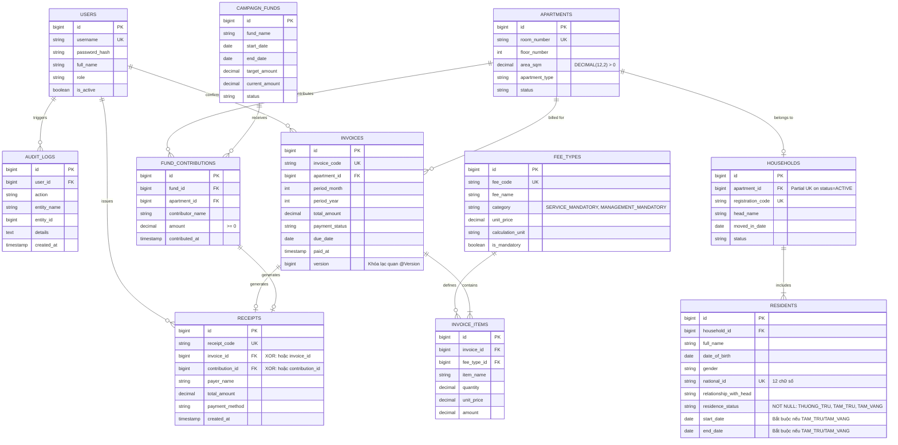

[🏠 Trang chủ Docs](../README.md) > [Giai đoạn 2: Thiết kế Hệ thống](./README.md) > **erd.md**

---

# MÔ HÌNH THỰC THỂ LIÊN KẾT (ENTITY-RELATIONSHIP DIAGRAM - ERD)
## Dự án: Hệ thống Quản lý Thu phí và Dân cư Chung cư BlueMoon (BlueMoon BFMS)

---

## 1. Sơ đồ Quan hệ Thực thể (Mermaid ERD)

---

## 2. Chi tiết các Thực thể (Data Dictionary)

| Thực thể | Tên bảng | Ý nghĩa nghiệp vụ | Khóa chính | Khóa ngoại & Ràng buộc cốt lõi |
|---|---|---|---|---|
| Người dùng | `users` | Tài khoản BQT, Kế toán, Thủ quỹ, Cư dân | `id` | `username` (UK), BCrypt hash, RBAC |
| Căn hộ | `apartments` | 30 tầng căn hộ (Kiot, Nhà ở, Penthouse) | `id` | `room_number` (UK), `area_sqm > 0` |
| Hộ khẩu | `households` | Sổ hộ khẩu gắn với căn hộ | `id` | `apartment_id` $\rightarrow$ `apartments(id)` (Partial UK on `status = 'ACTIVE'`) |
| Nhân khẩu | `residents` | Cư dân sinh sống (thường trú, tạm trú, tạm vắng) | `id` | `household_id` $\rightarrow$ `households(id)`, `national_id` 12 số, `start_date` & `end_date` bắt buộc với tạm trú/vắng |
| Loại phí | `fee_types` | Biểu phí dịch vụ và quản lý bắt buộc theo $m^2$ | `id` | `fee_code` (UK), chỉ gồm `SERVICE_MANDATORY` và `MANAGEMENT_MANDATORY` |
| Chiến dịch quỹ | `campaign_funds` | Đợt vận động tự nguyện độc lập (Vì người nghèo, Biển đảo) | `id` | Quản lý độc lập khỏi công nợ bắt buộc |
| Hóa đơn | `invoices` | Bảng kê tiền phí định kỳ hàng tháng của căn hộ | `id` | `apartment_id` $\rightarrow$ `apartments(id)`, Khóa lạc quan `version BIGINT` |
| Chi tiết hóa đơn | `invoice_items` | Từng khoản tính theo $m^2$ trong hóa đơn | `id` | `invoice_id` $\rightarrow$ `invoices(id)`, `fee_type_id` $\rightarrow$ `fee_types(id)` |
| Đóng góp quỹ | `fund_contributions` | Giao dịch ủng hộ quỹ tự nguyện tại quầy (tùy tâm $\ge 0$) | `id` | `fund_id` $\rightarrow$ `campaign_funds(id)`, `apartment_id` $\rightarrow$ `apartments(id)` |
| Biên lai | `receipts` | Phiếu thu/xác nhận xuất cho cư dân khi nộp tiền | `id` | Ràng buộc XOR: Trỏ tới `invoice_id` HOẶC `contribution_id`, không gộp chung |
| Nhật ký | `audit_logs` | Lịch sử thao tác biến động nhân khẩu và tiền | `id` | `user_id` $\rightarrow$ `users(id)` |

*Chi tiết các câu lệnh SQL khởi tạo được lưu trữ tại:* [`database/schema.sql`](../../database/schema.sql) và [`database/seed_data.sql`](../../database/seed_data.sql).
