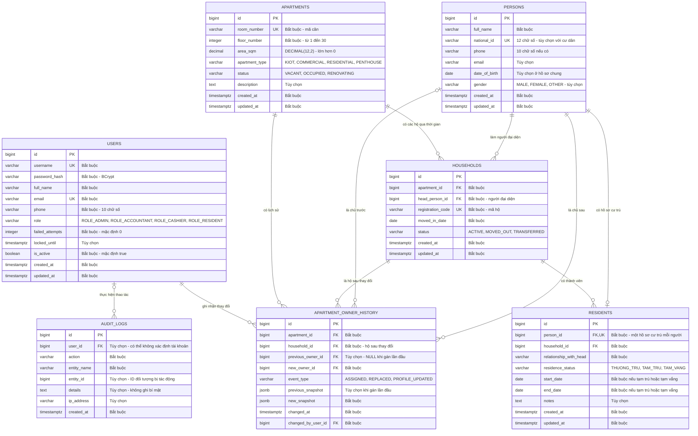

# ERD chi tiết Sprint 1 — đề xuất đang thảo luận

Cập nhật: 02/11/2026. Người phụ trách xem xét: Nguyễn Xuân Sơn.

**Trạng thái 02/11/2026:** Sơn yêu cầu triển khai DDL theo ERD này vào `database/schema.sql`. Đã có bootstrap 7 bảng và trigger, đã kiểm thử trên PostgreSQL 17 cô lập; chưa áp dụng lên VM và chưa nghiệm thu nghiệp vụ/Sprint. Xem [hướng dẫn và giới hạn](../../database/README.md) và [báo cáo kiểm tra](../../database/tests/SPRINT1_SCHEMA_VERIFICATION.md).

- Phạm vi: US-SEC-01, US-SEC-02 / NFR-02; US-001 / RAW-001, RAW-002.
- Task liên quan: DB-01, BE-01, BE-02, DB-02, BE-03; kiểm thử QA-05 và UAT BA-03.
- Nguồn quyết định: [quy chuẩn hiện hành](../PROJECT_CONVENTIONS.md), [US/AC](../01_requirements_and_planning/05_chi_tiet_us_va_acceptance_criteria.md), [backlog Sprint 1](../sprints/sprint-1/github_issues_backlog.md).
- Đối chiếu cấu trúc hiện có: [ERD tổng thể](erd.md), [schema SQL](../../database/schema.sql).

## 1. Phân biệt các thực thể

| Thực thể | Câu hỏi được trả lời | Vai trò |
|---|---|---|
| `users` | Ai đăng nhập và thao tác phần mềm? | Tài khoản, mật khẩu băm, quyền và khóa đăng nhập. |
| `persons` | Người được quản lý là ai? | Nguồn hồ sơ cá nhân chung: họ tên, CCCD, liên hệ. |
| `residents` | Người đó cư trú tại hộ nào, trạng thái gì? | Tham chiếu hồ sơ cá nhân và hộ; lưu quan hệ, trạng thái và thời hạn cư trú. |
| `apartments` | Mặt bằng nào đang được quản lý? | Mã căn, tầng, diện tích, loại và trạng thái. |
| `households` | Hộ nào gắn với căn hộ, ai đại diện? | Hộ hiện tại và hộ lịch sử, tham chiếu người đại diện. |
| `apartment_owner_history` | Chủ hộ thay đổi như thế nào? | Người trước/sau, bản chụp hồ sơ, thời điểm và tài khoản thực hiện. |
| `audit_logs` | Hệ thống đã ghi nhận thao tác gì? | Nhật ký tài khoản, căn hộ và nghiệp vụ; không lưu bí mật. |

Chủ hộ không nhất thiết có tài khoản hoặc trực tiếp cư trú tại căn hộ. Nhân viên BQT có tài khoản không nhất thiết là cư dân. Chưa thiết kế liên kết `users` với `persons` cho cổng cư dân trong Sprint 1.

## 2. Sơ đồ thuộc tính và quan hệ

`PK`: khóa chính; `FK`: khóa ngoại; `UK`: duy nhất. `||`: đúng một; `o|`: không hoặc một; `o{`: không hoặc nhiều. Thuộc tính ghi “tùy chọn” được phép NULL. Độ dài VARCHAR và CHECK chi tiết sẽ được chốt trong DDL; sơ đồ không thay thế DDL.

## 3. Ràng buộc bổ sung ngoài đường nối ERD

| Nội dung | Quy tắc đề xuất |
|---|---|
| Hộ hoạt động | Unique index trên `households(apartment_id)` với điều kiện `status='ACTIVE'`; không đặt UNIQUE thông thường trên `apartment_id`. |
| Hồ sơ chủ hộ | Người được `head_person_id` tham chiếu phải có CCCD và SĐT hợp lệ. |
| Tầng và loại | Tầng 1 KIOT; 2–5 COMMERCIAL; 6–29 RESIDENTIAL; 30 PENTHOUSE. |
| Thời hạn cư trú | Tạm trú/tạm vắng bắt buộc đủ ngày, `end_date >= start_date`. |
| Lịch sử và hộ | `household_id` trong lịch sử phải thuộc `apartment_id` của sự kiện. |
| Gán lần đầu | Chủ trước và snapshot trước NULL. |
| Thay đại diện | Chủ trước và chủ sau khác nhau. |
| Sửa hồ sơ | Chủ trước và chủ sau cùng ID; lưu snapshot trước/sau. |

Một người có thể đại diện nhiều hộ, nhưng `UNIQUE(residents.person_id)` giữ chính sách một hồ sơ cư trú mỗi người của đề xuất Sprint 1. Chưa mở rộng cư trú nhiều–nhiều; mâu thuẫn với risk log cũ cần được nhóm chốt riêng.

## 4. Giải thích lịch sử chủ hộ

Snapshot là bản chụp họ tên, CCCD, SĐT, email tại thời điểm xảy ra sự kiện, lưu bằng JSONB. ID giúp nhận diện người; snapshot giúp giữ thông tin lúc bàn giao dù hồ sơ hiện tại được sửa. Snapshot không phải nguồn hồ sơ hiện hành và cần được bảo vệ như hồ sơ gốc.

`changed_by_user_id` tham chiếu `users.id`: tài khoản đăng nhập đã thực hiện thay đổi, không phải chủ mới hoặc chủ cũ. Backend lấy ID từ phiên đăng nhập, không nhận tùy ý từ form. `changed_at` là thời điểm thao tác.

Ví dụ: An bàn giao cho Lan, kế toán Bình xác nhận trong phần mềm. `previous_owner_id` trỏ hồ sơ An; `new_owner_id` trỏ hồ sơ Lan; `changed_by_user_id` trỏ tài khoản Bình.

## 5. Ảnh hưởng tới database hiện có

- Thêm `persons` và `apartment_owner_history`.
- Thay `households.head_name` bằng `head_person_id`; chuyển thông tin cá nhân từ `residents` sang `persons`.
- Theo yêu cầu ghi đè schema tập trung Sprint 1, bootstrap hiện chỉ tạo 7 bảng trong sơ đồ này. Thiết kế tài chính trước đây được lưu ở [schema cũ](../../database/legacy/schema_before_sprint1.sql); chưa tạo `invoices` hoặc ràng buộc phiếu thu trong bootstrap mới. Phần nền DB-01 cho tài chính phải được bổ sung lại trước khi triển khai phân hệ đó; không ghi toàn bộ DB-01 đã hoàn thành.
- **Không yêu cầu xóa toàn bộ database.** Sơn cho biết VM chưa có dữ liệu; vẫn cần kiểm tra cấu trúc thực tế trước khi triển khai. Không chạy DROP/TRUNCATE hoặc chuyển đổi dữ liệu chỉ dựa vào tài liệu đề xuất này.
- Schema SQL, seed và bảng ánh xạ đã đồng bộ theo 7 bảng này. Seed dùng dữ liệu giả, chỉ chạy khi cả 7 bảng không có bản ghi. Entity/Service cần triển khai theo bảng ánh xạ; chưa có migration chuyển đổi cấu trúc.

## 6. Nội dung tiếp tục hỏi đáp

Tiếp tục xem xét sự cần thiết của từng bảng/trường, cách lưu snapshot và quy tắc thay chủ hộ. Tài liệu ghi lại phương án đã trao đổi để cả nhóm cùng đọc; không biến các đề xuất thành quyết định đã nghiệm thu.
