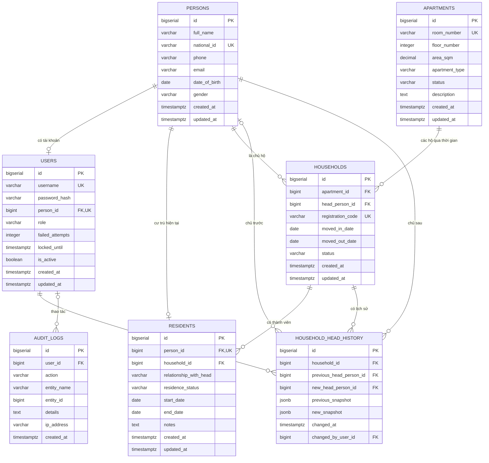

# ERD Sprint 1 — mô hình dữ liệu 04/11/2026

Truy vết: US-001 / RAW-001, RAW-002; US-SEC-01/02 / NFR-02; DB-01, DB-02, BE-01/02/03. QA-05, BA-03 kiểm tra/nghiệm thu theo phạm vi. `residents` là nền cho US-002/003, chưa triển khai các story đó.

Đã cập nhật thiết kế, DDL và seed cho database trống; không migration, không áp dụng VM, không triển khai Java. Kết quả thực chạy xem [báo cáo](../../database/tests/ERD_REVISION_VERIFICATION.md). Không đồng nhất kiểm tra DDL với nghiệm thu Sprint.

Nguồn: [quy chuẩn](../PROJECT_CONVENTIONS.md), [US/AC](../01_requirements_and_planning/05_chi_tiet_us_va_acceptance_criteria.md), [schema](../../database/schema.sql), [ánh xạ](../sprints/sprint-1/DATA_NAMING_CONVENTIONS.md). [Bản 02/11 lịch sử](erd_sprint_1_2026_11_02_historical.md) không còn là thiết kế hiện hành.

## 1. Thực thể, thuộc tính và quan hệ

`persons` lưu hồ sơ cá nhân dùng chung cho cư dân, chủ hộ và nhân viên có tài khoản. `users` chỉ lưu tài khoản/quyền; `residents` lưu hồ sơ cư trú hiện tại. Chủ hộ là vai trò trong hộ, không phải quyền sở hữu căn hộ. Không quản lý mua bán/chuyển nhượng.

## 2. Quy tắc dữ liệu

- `users.person_id`: FK, NOT NULL, UNIQUE. Người có thể chưa có tài khoản; nhân viên có tài khoản không bắt buộc cư trú. Tên, email, điện thoại chỉ lưu tại persons.
- Người có tài khoản phải có điện thoại 10 số và email đúng dạng cơ bản. Username/email lưu dạng lowercase sau khi trim; email duy nhất giữa những người có tài khoản kể cả tài khoản vô hiệu hóa. Cư dân chưa có tài khoản được trùng email. Email tối đa 255 ký tự. CHECK không chứng minh email có thể nhận thư.
- Diện tích DECIMAL(12,2) > 0; tầng 1–30; loại thuộc KIOT/COMMERCIAL/RESIDENTIAL/PENTHOUSE độc lập tầng. Một tầng có thể có nhiều loại. Không thêm bảng Floor.
- Họ tên lưu sau khi trim; room_number và registration_code lưu uppercase sau khi trim. Database từ chối chuỗi chưa chuẩn hóa, Service chuẩn hóa trước khi lưu.
- `apartments.status`: VACANT/OCCUPIED do BQT xác nhận, không tự suy từ hộ ACTIVE. Sửa chữa ngoài phạm vi Sprint 1.
- Hộ gắn cố định một căn; đổi apartment_id bị chặn. Chuyển căn: kết thúc hộ cũ, tạo hộ mới và dùng lại persons. Tối đa một hộ ACTIVE/căn; household khác vẫn được lưu như lịch sử. ACTIVE bắt buộc moved_out_date NULL; hộ MOVED_OUT/TRANSFERRED được để NULL nếu chưa rõ ngày, còn ngày đã biết không được trước moved_in_date.
- Chủ hộ có CCCD và SĐT hợp lệ; không bắt buộc có dòng residents. Không tự suy vai trò đăng nhập từ vai trò chủ hộ.
- `residents.person_id` duy nhất: một hồ sơ hiện tại/người, chưa phải bảng các lần cư trú. Quan hệ HEAD/SPOUSE/CHILD/PARENT/TENANT/OTHER. HEAD tương đương person_id = head_person_id của chính hộ đó; kiểm tra cuối transaction cả khi đổi chủ hộ hoặc đổi cư trú.
- Trạng thái THUONG_TRU/TAM_TRU/TAM_VANG; thường trú không có start_date/end_date, tạm trú/vắng cần đủ hai ngày và kết thúc không trước bắt đầu.
- Lịch sử chỉ giữ household_id; truy căn qua hộ. Chủ trước NULL và snapshot trước NULL khi gán đầu; các lần khác phải có cả hai. Hai ID khác nhau là REPLACED, bằng nhau là PROFILE_UPDATED; loại được suy ra, không lưu event_type.
- Snapshot là hồ sơ lúc xảy ra sự kiện (full_name, national_id, phone, email), không phải hồ sơ hiện tại. CHECK xác minh object, khóa bắt buộc, kiểu và định dạng; cho phép khóa mở rộng. Service vẫn phải bảo đảm giá trị là ảnh chụp trước/sau thật. Bảo vệ snapshot như dữ liệu cá nhân; không dùng để công khai. Lịch sử/audit chỉ thêm, không sửa/xóa/truncate bằng quyền ứng dụng thông thường.

## 3. Transaction và trách nhiệm ứng dụng

Các lượt ghi persons/users/households/residents lấy chung advisory transaction lock `(3180,13)` trước khi khóa hàng. Chỉ hỗ trợ READ COMMITTED cho các lượt ghi này; mức cô lập khác bị từ chối để tránh kiểm tra với snapshot cũ. Khóa tồn tại đến COMMIT/ROLLBACK. Đổi email/cấp tài khoản và đổi chủ/cư trú được kiểm tra cuối transaction trên trạng thái đã cập nhật. Đây là khóa thô ưu tiên tính đúng trong Sprint 1; chưa chứng minh NFR chịu tải.

Service phải cập nhật chủ hộ, rà soát quan hệ các thành viên, chụp thông tin trước/sau, ghi lịch sử và audit trong cùng `@Transactional(rollbackFor = Exception.class)` — tương đương BEGIN/COMMIT/ROLLBACK. Actor lấy từ phiên đăng nhập. Trigger không tự sinh lịch sử, không xác minh snapshot là dữ liệu trước/sau thật, không thay phân quyền. Cấm thao tác SQL quản trị phá chuỗi lịch sử trong luồng nghiệp vụ.

Bootstrap do database owner thực hiện. Ứng dụng dùng role `bluemoon_app` không sở hữu object: được đọc/ghi bảng nghiệp vụ theo quyền cấp, chỉ SELECT/INSERT lịch sử và audit, không có ALTER/TRIGGER/TRUNCATE. Seed là thao tác maintenance-only trên database mới khi ứng dụng đã dừng; gặp writer thì timeout và rollback.

## 4. Khóa ứng viên và phụ thuộc hàm

| Bảng | Khóa ứng viên | Phụ thuộc và nhận định |
|---|---|---|
| persons | id | id xác định hồ sơ; CCCD nullable chỉ duy nhất khi có, không là khóa cho mọi dòng. |
| users | id; username; person_id | Mỗi khóa xác định dữ liệu tài khoản; không sao chép hồ sơ người. |
| apartments | id; room_number | Khóa xác định tầng, loại, diện tích, trạng thái; tầng không quyết định loại theo quy tắc mới. |
| households | id; registration_code | Khóa xác định căn và chủ hộ; partial unique hộ ACTIVE không là khóa cho mọi dòng. |
| residents | id; person_id | Khóa xác định cư trú hiện tại; không lưu lại tên/CCCD. |
| household_head_history | id | id xác định sự kiện; không lưu căn suy ra qua hộ. Snapshot là dữ liệu tài liệu lịch sử có chủ đích. |
| audit_logs | id | id xác định lần thao tác; entity_name + entity_id xác định đối tượng, không xác định duy nhất lần thao tác. |

Không còn hai phụ thuộc bắc cầu đã nêu trong rà soát. Các cột quan hệ có cấu trúc hướng tới 3NF theo những phụ thuộc đã xác định; không tuyên bố các trường JSONB/text nội bộ được chứng minh 1NF–3NF. Audit dùng đích đa hình, không có FK thông thường tới mọi loại đối tượng.
