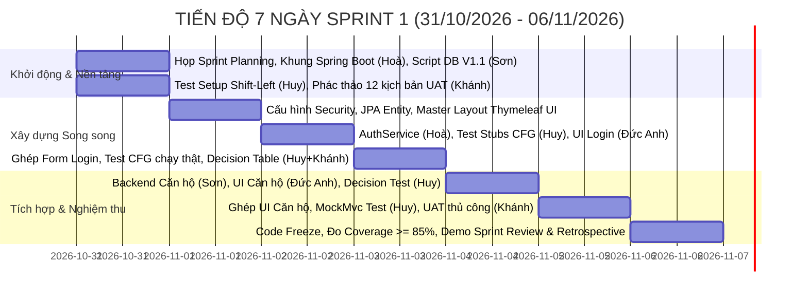

# KẾ HOẠCH CHI TIẾT TRIỂN KHAI SPRINT 1 — DỰ ÁN BLUEMOON BFMS
## Phân hệ: Khởi tạo Nền tảng Kiến trúc, Database Schema & Quản lý Tài khoản BQT / Đăng nhập
### Học phần: Nhập môn Công nghệ Phần mềm (IT3180) — SoICT / HUST
**Nhóm thực hiện:** Nhóm 13 (Team 13)
**Thời gian thực hiện Sprint 1:** 7 ngày liên tục (Từ Thứ Bảy 31/10/2026 đến Thứ Sáu 06/11/2026)
**Phiên bản kế hoạch:** 2.2 (điều chỉnh phân công 01/11/2026)
**Tiêu chuẩn áp dụng:** Hướng dẫn Đồ án Công nghệ Phần mềm SoICT (Chương 8 & 9), Bất biến Nghiệp vụ `AGENTS.md`

> [!NOTE]
> **ĐIỀU HƯỚNG TÀI LIỆU SPRINT 1 THEO MÔ-ĐUN:**
> Kế hoạch Sprint 1 đã được phân rã thành các tệp cẩm nang chuyên biệt cho từng thành viên và bộ thẻ GitHub Kanban tại:
> 📂 [**`docs/sprints/sprint-1/README.md`**](./sprints/sprint-1/README.md)
> - 📄 Cẩm nang thành viên: [TV1 Khánh](./sprints/sprint-1/TV1_Khanh_PO_BA.md) | [TV2 Sơn](./sprints/sprint-1/TV2_Son_Database_Backend.md) | [TV3 Hoà](./sprints/sprint-1/TV3_Hoa_TechLead_Security.md) | [TV4 Đức Anh](./sprints/sprint-1/TV4_DucAnh_Frontend_UI.md) | [TV5 Huy](./sprints/sprint-1/TV5_Huy_QA_Automation.md)
> - 📋 Danh mục 24 Gói cha GitHub Issues Backlog: [github_issues_backlog.md](./sprints/sprint-1/github_issues_backlog.md)
> - 📐 Chứng minh Toán học CFG & Decision Table: [kiem_thu_hoc_thuat_cfg_decision_table.md](./sprints/sprint-1/kiem_thu_hoc_thuat_cfg_decision_table.md)

---

> **Đọc luồng trước khi nhận việc:** [đồ thị chung và năm luồng cá nhân](sprints/sprint-1/WORKFLOW_GUIDE.md). Khánh vận hành Sprint; Sơn phụ trách DB/Backend và nghiệm thu; review kỹ thuật theo quy tắc Sơn–Hoà.

## 1. THÔNG TIN TỔNG QUAN SPRINT 1 (SPRINT OVERVIEW)

### 1.1. Thông tin Cơ bản
- **Tên Sprint:** Sprint 1 — Khởi tạo Nền tảng Kiến trúc Spring Boot, Chuẩn hóa Database Schema & Xây dựng Phân hệ Quản lý Tài khoản BQT / Xác thực Đăng nhập.
- **Thời lượng:** Đúng **7 ngày liên tục** (từ Thứ Bảy 31/10/2026 đến Thứ Sáu 06/11/2026).
- **Quy mô Nhân sự:** 5 thành viên; tổng nhu cầu cập nhật **138 giờ**, gồm 117 giờ gốc + 18 giờ chủ hộ + 3 giờ review của Sơn. Đây là ước lượng cần theo dõi hằng ngày, không phải bằng chứng đủ năng lực.
- **Ước lượng cập nhật:** **36 SP / 24 gói cha**. Giao phần việc 2–4 giờ theo backlog; ưu tiên ba US trong tuần đầu, không thêm nghiệp vụ ngoài Sprint.

### 1.2. Mục tiêu Cốt lõi của Sprint (Sprint Goal)
> **Sprint Goal:**
> Thiết lập hoàn chỉnh khung kiến trúc dự án **Spring Boot 3.5.16 (Java 25 LTS)** theo mô hình phân tầng thuần Web (Pure Web Architecture), kết nối và hoàn thiện kịch bản CSDL **PostgreSQL** (vá triệt để các lỗi thiếu `start_date`/`end_date` và `version`), hiện thực hóa thành công phân hệ **Xác thực Đăng nhập, Cơ chế khóa Brute-force 15 phút sau 5 lần sai, Quản lý Tài khoản Ban Quản trị & Phân quyền RBAC**, kết hợp phân hệ **Quản lý Căn hộ & Chủ hộ** nền tảng, đáp ứng 100% tiêu chí kiểm thử Shift-Left và chuẩn mực học thuật của Viện CNTT&TT (SoICT / HUST).

### 1.3. Căn cứ Quy chiếu & Phạm vi Nghiệp vụ Sprint 1
Sprint 1 quy chuẩn phạm vi thực thi bao gồm 3 nhóm hạng mục:
1. **Phân hệ Nghiệp vụ Căn hộ & Không gian Tòa nhà (Business Feature):**
   - **US-001 (thuộc 11 User Stories gốc trong `05_chi_tiet_us_va_acceptance_criteria.md`):** *Khởi tạo và Quản lý Danh mục Căn hộ (30 tầng bao gồm Kiot tầng 1, Thương mại tầng 2–5, Căn hộ tầng 6–29, Penthouse tầng 30) và Thông tin Hồ sơ Chủ hộ đại diện.*
2. **Phân hệ Nền tảng Xác thực & Quản trị BQT (Core Workflow 1 theo Đề bài gốc & `AGENTS.md`):**
   - **Xác thực Đăng nhập & Khóa Brute-force (`TASK-SEC-AUTH` / quy chiếu `US-SEC-02`):** Xác thực Người dùng, Đăng nhập hệ thống, Kiểm soát phiên Session, Khóa tài khoản tạm thời 15 phút sau 5 lần nhập sai liên tiếp và Đổi mật khẩu chủ động.
   - **Quản lý Tài khoản Ban Quản trị & Phân quyền RBAC (`TASK-SEC-USER` / quy chiếu `US-SEC-01`):** Quản trị viên cấp cao (Admin) khởi tạo, cập nhật, kích hoạt/vô hiệu hóa tài khoản cho các thành viên BQT, Kế toán và Thủ quỹ.
3. **Nhiệm vụ Kỹ thuật Nền tảng (Technical Enablers & Quality):**
   - **TASK-TECH-01:** Khởi tạo khung dự án Spring Boot 3.5.16, cấu hình Pure Web đa tầng và xử lý ngoại lệ tập trung.
   - **TASK-TECH-02:** Nạp kịch bản Migration CSDL PostgreSQL `V1.1__fix_schema_and_seed.sql` và khởi tạo JPA Entities/Repositories.
   - **TASK-TECH-03 (Shift-Left Testing):** Thiết lập môi trường kiểm thử tự động, chuẩn bị sẵn dữ liệu mẫu fixture và khung kiểm thử từ Ngày 1.

---

## 2. PHÂN CÔNG CÔNG VIỆC CỤ THỂ CHO 5 THÀNH VIÊN (WORK BREAKDOWN & ASSIGNMENT)

Nhóm 13 gồm 5 thành viên được phân công giữ nguyên vẹn chuyên môn gốc, tối ưu hóa phối hợp và quy trình làm việc:

### 2.1. Bảng Tổng hợp Phân bổ Nhiệm vụ Toàn đội

| Thành viên | Vai trò Sprint 1 | Trách nhiệm chính trong 7 ngày | Mã nhiệm vụ (Task IDs) | Story Points | Giờ ước lượng | Tỷ trọng |
|---|---|---|---|:---:|:---:|:---:|
| **TV1: Phạm Nam Khánh** | Điều phối Sprint / BA & UAT | Vận hành Kanban/daily, theo dõi phụ thuộc, chủ trì Review/Retro; chuẩn hóa yêu cầu, thực hiện UAT và tổng hợp hồ sơ | `PM-01`, `PM-02`, `BA-03` | 6 SP | 22h | 15.94% |
| **TV2: Nguyễn Xuân Sơn** | Trưởng nhóm / Database Engineer & Backend Dev | Khắc phục Schema CSDL `V1.1`, Entity JPA, Backend CRUD Căn hộ & Chủ hộ (`US-001`) | `PM-03`, `DB-01`, `BE-01`, `BE-02`, `DB-02`, `BE-03` | 10 SP | 36h | 26.09% |
| **TV3: Phạm Thái Hoà** | Technical Lead & Core Backend Dev | Kiến trúc hệ thống, Spring Security 6, API Đăng nhập (`US-SEC-02`), Quản lý User (`US-SEC-01`), Code Review & Gatekeeping | `ARCH-01`, `SEC-01`, `SEC-02`, `SEC-03`, `SEC-04` | 8 SP | 28h | 20.29% |
| **TV4: Nghiêm Đức Anh** | Frontend Developer & UI/UX Specialist | Dựng Master Layout Thymeleaf, Giao diện Login, UI Quản lý tài khoản, UI Căn hộ 30 tầng | `FE-01`, `FE-02`, `FE-03`, `FE-04`, `FE-05` | 7 SP | 28h | 20.29% |
| **TV5: Nguyễn Hợp Huy** | QA Lead & Test Automation Engineer | Áp dụng Shift-Left: Cấu hình Test Framework, Unit Test CFG Basis Path, MockMvc Integration Test, Decision Table | `QA-01`, `QA-02`, `QA-03`, `QA-04`, `QA-05` | 5 SP | 24h | 17.39% |
| **TỔNG CỘNG** | | | **24 gói cha** | **36 SP** | **138h** | **100%** |

---

### 2.2. Chi tiết Nhiệm vụ & Tiêu chí Nghiệm thu Từng Thành viên

#### THÀNH VIÊN 1: PHẠM NAM KHÁNH — ĐIỀU PHỐI SPRINT / BUSINESS ANALYST & UAT
- **Trách nhiệm trọng tâm:** Vận hành Kanban/daily, theo dõi phụ thuộc và trở ngại, chủ trì Sprint Review/Retrospective, kiểm soát chất lượng hồ sơ đặc tả, trực tiếp soạn thảo kịch bản kiểm thử nghiệm thu (UAT) và thực hiện nghiệm thu chức năng trên giao diện web do Đức Anh xây dựng.
- **Sản phẩm đóng góp cụ thể trên Git:** File kịch bản `docs/sprints/sprint-1/UAT_SCENARIOS_SPRINT_1.md` và biên bản kết quả kiểm thử `docs/sprints/sprint-1/UAT_REPORT_SPRINT_1.md`.
- **Danh mục Nhiệm vụ Chi tiết:**

| Mã Task | Tên Nhiệm vụ | Mô tả Chi tiết Công việc | Ước lượng | Tiêu chí Hoàn thành (Acceptance Criteria) |
|---|---|---|:---:|---|

| **PM-01** | Vận hành Sprint 1 & Quản trị Tiến độ Scrum | • Thiết lập bảng Kanban Sprint 1 trên GitHub Projects / Trello.<br>• Tổ chức Daily Standup 10 phút hàng ngày.<br>• Theo dõi Burndown Chart 7 ngày.<br>• Tổ chức Demo Sprint Review và họp Retrospective ngày 06/11. | 6 giờ (2 SP) | • 100% thành viên cập nhật trạng thái task hàng ngày.<br>• Biên bản họp Sprint Review & Retrospective đầy đủ. |
| **PM-02** | Xây dựng Bộ Kịch bản UAT & Trực tiếp Nghiệm thu Giao diện | • Soạn thảo tài liệu `docs/sprints/sprint-1/UAT_SCENARIOS_SPRINT_1.md` gồm 12 kịch bản nền và các kịch bản chủ hộ BA-03 thực tế tại chung cư Văn Phú (đăng nhập đúng/sai, tài khoản bị khóa 15 phút, thêm căn hộ các tầng 1, 2-5, 6-29, 30).<br>• Trực tiếp thao tác kiểm thử thủ công trên giao diện web Thymeleaf do Đức Anh xây dựng.<br>• Lập nhật ký lỗi (Bug Log) chuyển cho Dev sửa.<br>• Đóng gói Báo cáo Nghiệm thu UAT (`docs/sprints/sprint-1/UAT_REPORT_SPRINT_1.md`). | 14 giờ (3 SP) | • File Markdown kịch bản UAT được commit lên repo Git.<br>• 100% các màn hình Login, Căn hộ, Quản lý tài khoản được kiểm thử và ký xác nhận đạt chuẩn. |

---

#### THÀNH VIÊN 2: NGUYỄN XUÂN SƠN — TRƯỞNG NHÓM / DATABASE ENGINEER & BACKEND DEVELOPER
- **Trách nhiệm trọng tâm:** Đảm bảo CSDL PostgreSQL chuẩn mực, khắc phục toàn bộ các lỗi phát hiện tại báo cáo audit, và hiện thực hóa phân hệ Căn hộ (`US-001`).
- **Danh mục Nhiệm vụ Chi tiết:**

| Mã Task | Tên Nhiệm vụ | Mô tả Chi tiết Công việc | Ước lượng | Tiêu chí Hoàn thành (Acceptance Criteria) |
|---|---|---|:---:|---|
| **DB-01** | Soạn thảo Kịch bản Migration CSDL `V1.1__fix_schema_and_seed.sql` | • Bổ sung `start_date`, `end_date` vào `residents` kèm check constraint ngày.<br>• Bổ sung `version BIGINT NOT NULL DEFAULT 0` vào `invoices`.<br>• Thêm ràng buộc XOR cho bảng `receipts`.<br>• Chuyển `apartments.area_sqm` sang `DECIMAL(12,2)`.<br>• Đổi khóa `households.apartment_id` sang Partial Unique Index (`status = 'ACTIVE'`).<br>• Cập nhật hash BCrypt chuẩn (`$2a$10$ThEK5Lsf49T189/5nvFzwuYgdsmzBFWloKeb2FM2QSwB4JsNK2uTK`) cho `Password@123` và bổ sung seed data cho `TAM_TRU`, `TAM_VANG`. | 7 giờ (2 SP) | • Kịch bản SQL chạy trơn tru không lỗi trên PostgreSQL 17 (Docker chuẩn nhóm).<br>• Toàn bộ 7 lỗi DDL và DML được vá 100%. |
| **BE-01** | Xây dựng Tầng Entity JPA & Repositories | • Ánh xạ JPA Entity chuẩn cho `User`, `Apartment`, `Household`, `Resident`.<br>• Khai báo `@Version` trên `Invoice` entity.<br>• Viết các Repository Interface kế thừa `JpaRepository` kèm custom JPQL query tìm kiếm căn hộ theo tầng, mã căn. | 9 giờ (2 SP) | • Entity ánh xạ chính xác 100% bảng CSDL.<br>• Không dùng `float`/`double`, toàn bộ diện tích dùng `BigDecimal`. |
| **BE-02** | Hiện thực hóa Backend CRUD Căn hộ (`US-001`) | • Viết `ApartmentService` và `ApartmentController`.<br>• Kiểm tra ràng buộc diện tích thông thủy strictly positive ($m^2 > 0$).<br>• Xử lý thêm/sửa/xóa logic căn hộ (30 tầng) và gán hồ sơ chủ hộ đại diện.<br>• Ghi nhật ký kiểm toán vào `AuditLog`. | 9 giờ (3 SP) | • Thỏa mãn AC 1–2 của US-001; AC 3–4 nghiệm thu kết hợp DB-02/BE-03/FE-05/QA-05.<br>• Chặn thành công diện tích $\le 0$ và mã căn trùng lặp.<br>• Phối hợp BE-03 để lưu lịch sử chủ hộ cũ an toàn. |

---

#### THÀNH VIÊN 3: PHẠM THÁI HOÀ — TECHNICAL LEAD & CORE BACKEND DEVELOPER
- **Trách nhiệm trọng tâm:** Thiết lập nền tảng kiến trúc phần mềm, cấu hình bảo mật Spring Security 6, xây dựng phân hệ Đăng nhập (`US-SEC-02`), Quản lý Tài khoản BQT (`US-SEC-01`), và giữ vai trò Gatekeeper kiểm duyệt chất lượng mã nguồn (Pull Request Review & Architecture Governance).
- **Danh mục Nhiệm vụ Chi tiết:**

| Mã Task | Tên Nhiệm vụ | Mô tả Chi tiết Công việc | Ước lượng | Tiêu chí Hoàn thành (Acceptance Criteria) |
|---|---|---|:---:|---|
| **ARCH-01** | Thiết lập Khung Kiến trúc Phân tầng & Cấu hình Hệ thống | • Chuẩn hóa cấu trúc Maven đa tầng theo quy chuẩn Pure Web (`controller`, `service`, `repository`, `model`, `dto`, `exception`).<br>• Thiết lập môi trường chạy trên **Java 25 LTS** và Spring Boot 3.5.16.<br>• Cấu hình kết nối HikariCP, JPA Hibernate trong `application.yml`.<br>• Viết Global Exception Handler (`@ControllerAdvice`). | 5 giờ (1 SP) | • Dự án biên dịch sạch sẽ (`mvn clean compile` không lỗi; ghi rõ cảnh báo môi trường còn lại).<br>• Khởi động kết nối PostgreSQL thành công. |
| **SEC-01** | Cấu hình Spring Security 6 & Quản trị Phiên (Session) | • Thiết lập `SecurityFilterChain` quản lý phân quyền theo Role (`ROLE_ADMIN`, `ROLE_ACCOUNTANT`, `ROLE_CASHIER`, `ROLE_RESIDENT`).<br>• Cấu hình bảo mật Form Login, Logout, Cookie Session, bảo vệ CSRF và Header XSS Protection.<br>• Khai báo Bean `BCryptPasswordEncoder` (10 rounds). | 6 giờ (2 SP) | • Truy cập các route nội bộ bị chặn khi chưa đăng nhập.<br>• Phân quyền route chuẩn xác theo vai trò. |
| **SEC-02** | Hiện thực hóa Service Xác thực & Đăng nhập (`US-SEC-02`) | • Lập trình `CustomUserDetailsService` và `AuthService`.<br>• Hiện thực hóa cơ chế đếm `failed_attempts` và tự động khóa tài khoản tạm thời 15 phút sau 5 lần nhập sai mật khẩu liên tiếp.<br>• Bổ sung kiểm tra cờ `is_active` ngăn tài khoản bị vô hiệu hóa đăng nhập; tự động reset biến đếm khi hết hạn khóa.<br>• Lập trình tính năng Đổi mật khẩu chủ động. | 8 giờ (2 SP) | • Đăng nhập thành công với tài khoản mẫu.<br>• Khóa tài khoản chính xác 15 phút sau lần thứ 5 đăng nhập sai.<br>• Mật khẩu mới được băm BCrypt trước khi lưu. |
| **SEC-03** | Hiện thực hóa Quản lý Tài khoản BQT (`US-SEC-01`) | • Lập trình `UserService` và `AdminController`.<br>• API/Web Controller tạo tài khoản mới cho cán bộ BQT, kích hoạt/khóa tài khoản.<br>• Kiểm tra trùng lặp `username`, `email`.<br>• Bọc toàn bộ thao tác trong `@Transactional(rollbackFor = Exception.class)`. | 6 giờ (2 SP) | • Chỉ Admin mới có quyền tạo và phân quyền tài khoản.<br>• Không thể tạo 2 tài khoản trùng username/email. |
| **SEC-04** | Code Review, PR Review & Architecture Gatekeeping | • Hoà review PR Sơn; PR Hoà do Sơn review; PR thành viên khác có ít nhất một trong Sơn/Hoà duyệt, không tự duyệt.<br>• Kiểm soát tuân thủ kiến trúc Pure Web (không để lọt SQL/business logic vào Controller hay View).<br>• Gatekeeper chất lượng: Đảm bảo không merge code có mùi mã (Code smells) hoặc vi phạm quy chuẩn SoICT. | 3 giờ (1 SP) | • 100% PR được review và approve trước khi merge vào nhánh develop.<br>• Không xảy ra xung đột merge hoặc suy thoái kiến trúc. |

---

#### THÀNH VIÊN 4: NGHIÊM ĐỨC ANH — FRONTEND DEVELOPER & UI/UX SPECIALIST
- **Trách nhiệm trọng tâm:** Thiết kế và xây dựng giao diện người dùng Thymeleaf đồng bộ, trực quan, chuyên nghiệp, responsive theo thương hiệu BlueMoon.
- **Danh mục Nhiệm vụ Chi tiết:**

| Mã Task | Tên Nhiệm vụ | Mô tả Chi tiết Công việc | Ước lượng | Tiêu chí Hoàn thành (Acceptance Criteria) |
|---|---|---|:---:|---|
| **FE-01** | Xây dựng Master Layout Thymeleaf Chuẩn mực | • Thiết kế khung giao diện Master Layout (`templates/fragments/layout.html`) gồm: Header (thông tin user, nút đăng xuất), Sidebar điều hướng, Footer bản quyền.<br>• Tích hợp Bootstrap 5 / Tailwind CSS và JavaScript hỗ trợ modal, dropdown.<br>• Đảm bảo tính Responsive trên Desktop và Tablet. | 6 giờ (1.5 SP) | • Master layout tái sử dụng được cho toàn bộ các trang con.<br>• Giao diện hiển thị sắc nét, không vỡ khung. |
| **FE-02** | Xây dựng Giao diện Màn hình Đăng nhập | • Hiện thực hóa `templates/auth/login.html` với logo BlueMoon chuyên nghiệp.<br>• Xử lý hiển thị thông báo lỗi rõ ràng khi sai tài khoản, trả lỗi chung không tiết lộ tài khoản tồn tại; quy tắc khóa theo US-SEC-02. | 6 giờ (1.5 SP) | • Form đăng nhập tương thích đầy đủ với Spring Security.<br>• Thông báo lỗi hiển thị bằng tiếng Việt thân thiện. |
| **FE-03** | Xây dựng Giao diện Quản lý Tài khoản BQT | • Trang danh sách tài khoản BQT (`templates/admin/users.html`) có phân trang, bộ lọc vai trò.<br>• Modal/Form tạo tài khoản mới, gán vai trò (`ROLE_ADMIN`, `ACCOUNTANT`, `CASHIER`).<br>• Modal đổi mật khẩu an toàn. | 6 giờ (1.5 SP) | • Giao diện trực quan, xác thực form phía client.<br>• Hiển thị badge trạng thái hoạt động / bị khóa. |
| **FE-04** | Xây dựng Màn hình Dashboard & Danh mục Căn hộ | • Trang Dashboard tổng quan (`templates/admin/dashboard.html`) hiển thị thẻ thống kê sơ bộ.<br>• Trang Danh mục Căn hộ (`templates/admin/apartments.html`): Bảng danh sách 30 tầng căn hộ, modal thêm/sửa căn hộ với trường diện tích $m^2$. | 6 giờ (1.5 SP) | • Hiển thị đúng dữ liệu căn hộ từ Controller.<br>• Chặn người dùng nhập số âm cho diện tích trên UI. |

---

#### THÀNH VIÊN 5: NGUYỄN HỢP HUY — QA LEAD & TEST AUTOMATION ENGINEER
- **Trách nhiệm trọng tâm:** Áp dụng phương pháp luận **Shift-Left Testing**, cấu hình framework kiểm thử từ Ngày 1, viết trước khung test stubs song song với quá trình Dev, bảo đảm độ bao phủ $\ge 85\%$ theo chuẩn SoICT.
- **Danh mục Nhiệm vụ Chi tiết:**

| Mã Task | Tên Nhiệm vụ | Mô tả Chi tiết Công việc | Ước lượng | Tiêu chí Hoàn thành (Acceptance Criteria) |
|---|---|---|:---:|---|
| **QA-01** | Thiết lập Khung & Môi trường Kiểm thử Tự động (Shift-Left) | • Cấu hình môi trường kiểm thử độc lập `application-test.yml` (H2 in-memory DB / mocks) cho phép chạy test tự động không cần môi trường DB bên ngoài.<br>• Thiết lập thư viện JUnit 5, Mockito, MockMvc, AssertJ.<br>• Xây dựng các lớp cơ sở (Base Test Classes) và bộ dữ liệu fixture dùng chung cho nhóm từ Ngày 1. | 4 giờ (1 SP) | • Chạy lệnh `mvn test` sạch sẽ không báo lỗi môi trường.<br>• Khung kiểm thử tự động sẵn sàng cho tầng Service và Controller. |
| **QA-02** | Lập trình Ca Kiểm thử CFG Basis Path (AuthService) | • Dựng trước khung kiểm thử `AuthServiceTest.java` (Test Stubs) từ Ngày 2.<br>• Chuyển hóa đồ thị dòng điều khiển CFG và các Basis Paths theo CFG đã chốt đã thiết kế trong Section 5 thành mã nguồn JUnit 5 thực thi ngay khi Hoà vừa push code.<br>• Bao phủ 100% các Basis Paths theo CFG đã chốt (`TC_LOGIN_BP_01` $\rightarrow$ `05`) và các ca biên vô hiệu hóa, reset, trước/đúng/sau thời điểm hết khóa theo tài liệu CFG. | 6 giờ (1 SP) | • Toàn bộ ca kiểm thử đã chốt luồng đăng nhập pass 100%.<br>• Báo cáo độ bao phủ nhánh rẽ đạt 100%. |
| **QA-03** | Lập trình Ca Kiểm thử Tham số hóa Decision Table (ApartmentService) | • Chuyển hóa Black-box Decision Table (6 Rules $R_1 \rightarrow R_6$ đã thiết kế trong Section 5) thành các ca kiểm thử tham số hóa `@ParameterizedTest` trong `ApartmentServiceTest.java`.<br>• Kiểm tra biên diện tích $\le 0$, số tầng ngoài dải $1 \le \text{floor} \le 30$, xung đột loại hình với số tầng. | 5 giờ (1 SP) | • Bắt chính xác 100% các ngoại lệ nghiệp vụ theo từng rule.<br>• Dữ liệu test tham số hóa bao phủ đầy đủ các hoán vị điều kiện biên. |
| **QA-04** | Lập trình Web Integration Test (MockMvc) & Đo lường Coverage | • Viết bộ ca kiểm thử tích hợp Controller với `MockMvc` cho `AuthController` và `AdminController`.<br>• Thực thi kiểm thử tự động, đo độ bao phủ mã nguồn (Line Coverage $\ge 85\%$).<br>• Đóng gói Báo cáo Tổng kết Đo lường Chất lượng Sprint 1 (`SPRINT_1_TEST_REPORT.md`) nộp SoICT. | 5 giờ (1 SP) | • 100% ca kiểm thử pass xanh (`BUILD SUCCESS`).<br>• Đo độ bao phủ đạt $\ge 85\%$ dòng lệnh cho tầng Service/Controller. |

---

### 2.3. Ma trận Phân định Trách nhiệm (RACI Matrix) Cập nhật Cho 5 Thành viên

Ma trận RACI bảo toàn 100% phân công chuyên môn gốc của nhóm:
- **R (Responsible):** Người trực tiếp thực hiện nhiệm vụ kỹ thuật / tạo ra sản phẩm bàn giao.
- **A (Accountable):** Người chịu trách nhiệm cao nhất về kết quả cuối cùng và phê duyệt chất lượng (mỗi hạng mục có duy nhất 1 cá nhân Accountable).
- **C (Consulted):** Người được tham vấn chuyên môn, đóng góp ý kiến nghiệp vụ và kỹ thuật 2 chiều.
- **I (Informed):** Người được cập nhật thông tin tiến độ và kết quả bàn giao một chiều.

| Hạng mục Công việc & Deliverables Sprint 1 | TV1: Khánh (BA/UAT) | TV2: Sơn (Trưởng nhóm/DB/BE) | TV3: Hoà (Tech Lead) | TV4: Đ.Anh (UI/UX) | TV5: Huy (QA Lead) |
|---|:---:|:---:|:---:|:---:|:---:|
| **D1: Khung Kiến trúc Spring Boot 3.5.16 & Pure Web** | I | C | **A / R** | C | I |
| **D2: Kịch bản Migration CSDL `V1.1` & Seed Data** | C | **R** | **A** | I | C |
| **D3a: Backend Xác thực, Khóa Brute-force & Quản lý User** | C | I | **A / R** | C | C |
| **D3b: Backend CRUD Danh mục Căn hộ & Chủ hộ (`US-001`)** | C | **R** | **A** | C | C |
| **D4: Bộ Giao diện Thymeleaf (Layout, Login, Admin)** | **C / Approver (UAT)** | I | **A** *(Kiến trúc)* | **R** *(Xây dựng)* | I |
| **D5: Bộ Ca Kiểm thử Tự động CFG/BVA & Test Report SoICT** | C | I | C | I | **A / R** |
| **Hồ sơ Kịch bản UAT & Báo cáo Nghiệm thu BQT** | **R** | **A** | C | I | C |
| **Điều phối Tiến độ Scrum, Burndown & Retrospective** | C | **A / R** | C | I | C |
| **Code Review, PR Review & Architecture Gatekeeping** | I | **R** | **A / R** | C | I |

---

## 3. ĐỊNH NGHĨA HOÀN THÀNH (DEFINITION OF DONE - DoD) THEO CHUẨN IT3180 / SoICT

Một User Story hoặc Nhiệm vụ Kỹ thuật chỉ được xem là **HOÀN THÀNH (DONE)** và sẵn sàng bàn giao khi thỏa mãn đầy đủ 6 nhóm tiêu chí khắt khe sau đây:

### 3.1. Tiêu chuẩn Mã nguồn & Lập trình Sạch (Clean Code & Conventions)
1. **Quy chuẩn Định dạng (Coding Conventions):**
   - Thụt lề chuẩn 4 dấu cách (4 spaces indentation), tuyệt đối không dùng tab lẫn lộn.
   - Đặt tên theo chuẩn Java: `camelCase` cho biến và phương thức, `PascalCase` cho tên Lớp và Interface, `UPPER_SNAKE_CASE` cho hằng số (`public static final`).
   - Tên phương thức phải mang tính hành động rõ ràng (`findByRoomNumber`, `authenticateUser`, `lockAccountAfterMaxAttempts`).
2. **Tài liệu hóa Javadoc Bắt buộc:**
   - 100% các lớp (Class), Interface và các phương thức `public` của tầng Service và Controller phải có Javadoc đầy đủ mô tả chức năng.
   - Phải có đầy đủ các thẻ quy chuẩn: `@param` (mô tả từng tham số đầu vào), `@return` (mô tả dữ liệu trả về), `@throws` (mô tả chi tiết các ngoại lệ nghiệp vụ có thể phát sinh).
3. **Loại bỏ Hoàn toàn Mùi Mã (Code Smells Prevention):**
   - **Không Shotgun Surgery:** Mỗi thay đổi nghiệp vụ chỉ được chỉnh sửa cục bộ tại một tầng trách nhiệm duy nhất.
   - **Không Duplicate Code:** Áp dụng triệt để nguyên lý DRY (Don't Repeat Yourself); các đoạn logic xử lý ngày tháng, chuỗi ký tự phải được đóng gói vào `util` dùng chung.
   - **Không Data Clump:** Đóng gói các nhóm trường dữ liệu liên quan thành DTO hoặc Value Object (ví dụ: `LoginRequestDTO`, `CreateApartmentDTO`).

### 3.2. Tiêu chuẩn Kiến trúc & Toàn vẹn Giao dịch
1. **Tuân thủ Tuyệt đối Phân tầng Thuần Web (Pure Web Architecture):**
   - Controller chỉ xử lý điều hướng, đón nhận request, kiểm tra hợp lệ DTO (`@Valid`) và trả về View/DTO. **Tuyệt đối CẤM** viết câu lệnh SQL/JPA hoặc logic tính toán tiền bạc trong Controller.
   - Toàn bộ logic nghiệp vụ phải đóng gói 100% trong Service.
   - Không chạy câu lệnh truy vấn CSDL bên trong Thymeleaf View.
2. **Bảo đảm Tính toàn vẹn Dữ liệu (ACID Transactions):**
   - Mọi phương thức Service có thao tác ghi dữ liệu (Thêm, Sửa, Xóa, Đổi trạng thái) bắt buộc phải được gắn annotation `@Transactional(rollbackFor = Exception.class)`.

### 3.3. Tiêu chuẩn An toàn & Bảo mật Thông tin
1. **Bảo vệ Mật khẩu:**
   - Tuyệt đối **CẤM** lưu trữ mật khẩu dưới dạng văn bản thô (plain text) ở bất kỳ đâu (CSDL, log, biến tạm).
   - Bắt buộc mã hóa mật khẩu bằng thuật toán **BCrypt** với độ phức tạp tối thiểu 10 rounds (`BCryptPasswordEncoder`).
2. **Phòng chống Tấn công Brute-Force:**
   - Hệ thống tự động đếm số lần đăng nhập sai liên tiếp.
   - Sau đúng **5 lần đăng nhập sai**, tài khoản bị tự động khóa tạm thời trong **15 phút** (`locked_until = now() + 15m`). Tuyệt đối không xóa tài khoản để phòng ngừa tấn công từ chối dịch vụ (DoS).
3. **Phòng chống Lỗ hổng Web Phổ biến:**
   - Tầng Repository bắt buộc dùng JPQL có tham số hoặc Spring Data Query Methods để chống triệt để **SQL Injection**.
   - Bật cờ bảo vệ chống **CSRF** trên Spring Security cho toàn bộ các Form POST/PUT.
   - Mã hóa dữ liệu đầu ra trên Thymeleaf (mặc định của `th:text`) để chống tấn công **XSS**.

### 3.4. Tiêu chuẩn Kiểm thử & Đo lường Chất lượng (SoICT Chapter 8 & 9)
1. **Độ bao phủ Kiểm thử (Test Coverage):**
   - Bộ ca kiểm thử tự động (Unit Test & Integration Test) phải đạt độ bao phủ dòng lệnh (Line Coverage) $\ge 85\%$ đối với tầng Service và Controller.
   - 100% các ca kiểm thử trong bộ test suite phải thực thi thành công (Pass xanh), không có bất kỳ lỗi fail hay error nào.
2. **Kiểm thử Luồng Điều khiển (Control Flow Testing - Chapter 8):**
   - Đối với phương thức lõi `authenticateUser()`, phải lập biểu đồ CFG, tính toán $V(G)$ và thiết kế ca kiểm thử bao phủ toàn bộ tập đường dẫn cơ sở (Basis Path Coverage).
3. **Kiểm thử Bảng Quyết định (Decision Table Testing - Chapter 9):**
   - Chức năng kiểm soát khóa tài khoản và kiểm tra tính hợp lệ căn hộ phải có Bảng quyết định kiểm thử hộp đen bao phủ toàn bộ các hoán vị điều kiện biên.

### 3.5. Tiêu chuẩn Đánh giá Tĩnh & Tích hợp (Static Code Analysis)
- Chạy công cụ kiểm tra tĩnh (SonarLint / Maven Checkstyle): **0 lỗi Blocker, 0 lỗi Critical, 0 lỗ hổng bảo mật (Vulnerabilities)**.
- Mã nguồn được commit lên Git nhánh `develop` với thông điệp chuẩn mực (Conventional Commits: `feat:`, `fix:`, `test:`, `docs:`), đã giải quyết xong merge conflict và được Pull Request Review bởi Tech Lead (Hoà).

---

## 4. DANH MỤC DELIVERABLES CỦA SPRINT 1 (SPRINT 1 DELIVERABLES)

Sprint 1 cam kết bàn giao đầy đủ 5 sản phẩm bàn giao kỹ thuật kèm bộ hồ sơ nghiệm thu thực tế:

```
DELIVERABLES SPRINT 1 (31/10 - 06/11/2026)
├── D1: Mã nguồn Khung Kiến trúc Phân tầng Spring Boot 3.5.16 (Java 25 LTS)
├── D2: Bộ Kịch bản CSDL PostgreSQL Hoàn thiện (Migration V1.1 Script)
├── D3: Phân hệ Backend API/Service/Controller Xác thực & Quản lý Tài khoản BQT
├── D4: Bộ Giao diện Người dùng Thymeleaf Hoàn chỉnh (Layout, Login, Dashboard, Users, Apartments)
├── D5: Bộ Ca Kiểm thử Tự động & Báo cáo Đo lường Chất lượng Chuẩn SoICT
└── D-UAT: Bộ Hồ sơ Kịch bản Kiểm thử Chấp nhận & Báo cáo Nghiệm thu BQT (Khánh phụ trách)
```

### Deliverable D1: Mã nguồn Khung Kiến trúc Phân tầng Chuẩn mực
- **Vị trí lưu trữ:** `src/main/java/com/bluemoon/bfms/`
- **Mô tả thành phần:**
  - `BlueMoonBfmsApplication.java`: Điểm khởi chạy ứng dụng Spring Boot 3.5.16 trên nền tảng Java 25 LTS.
  - Cấu trúc các package phân tầng rõ rệt: `controller`, `service`, `repository`, `model`, `dto`, `exception`, `config`, `util`.
  - `config/SecurityConfig.java`: Cấu hình Spring Security 6 với `SecurityFilterChain`, `BCryptPasswordEncoder`, cấu hình Session Management và phân quyền route.
  - `exception/GlobalExceptionHandler.java`: Xử lý ngoại lệ tập trung, bắt ngoại lệ validation `@Valid`, ngoại lệ bảo mật và ngoại lệ khóa lạc quan `ObjectOptimisticLockingFailureException`.
  - `pom.xml`: Khai báo phụ thuộc chuẩn mực, không thừa thư viện bên ngoài.

### Deliverable D2: Bộ Kịch bản Migration CSDL PostgreSQL Hoàn thiện
- **Vị trí lưu trữ:** `database/migrations/V1.1__fix_schema_and_seed.sql`
- **Nội dung sửa đổi cốt lõi:**
  1. Thiết lập `ALTER TABLE residents ALTER COLUMN residence_status SET NOT NULL;` (triệt tiêu lỗ hổng SQL 3-valued logic bypass check constraints), đồng thời thêm 2 cột `start_date DATE` và `end_date DATE` kèm ràng buộc kiểm tra hợp lệ thời hạn tạm trú/tạm vắng theo Luật Cư trú 2020.
  2. Bổ sung cột `version BIGINT NOT NULL DEFAULT 0` vào bảng `invoices` để kích hoạt cơ chế khóa lạc quan `@Version` (khẳng định chuẩn kiểu `BIGINT` khớp 1:1 với kiểu `Long` của Hibernate/JPA, ngăn ngừa ngoại lệ `SchemaManagementException`).
  3. Bổ sung ràng buộc XOR độc lập vào bảng `receipts` để chống in gộp biên lai thu phí với biên lai quỹ.
  4. Đổi kiểu dữ liệu `apartments.area_sqm` sang `DECIMAL(12,2)`.
  5. Chuyển ràng buộc `households.apartment_id UNIQUE` sang Partial Unique Index (`status = 'ACTIVE'`) để bảo toàn lịch sử chủ hộ cũ.
  6. Thay thế toàn bộ mật khẩu băm giả lập trong `seed_data.sql` bằng mã băm BCrypt chuẩn đã được kiểm chứng thực nghiệm độc lập của `'Password@123'` (`$2a$10$ThEK5Lsf49T189/5nvFzwuYgdsmzBFWloKeb2FM2QSwB4JsNK2uTK`).
  7. Nạp đầy đủ dữ liệu mẫu cho các trường hợp `TAM_TRU`, `TAM_VANG` và các dòng chi tiết hóa đơn.

### Deliverable D3: Backend API / Service / Controller Xác thực & Tài khoản BQT
- **Vị trí lưu trữ:** `src/main/java/com/bluemoon/bfms/service/`, `controller/`
- **Mô tả chức năng:**
  - `AuthService` & `AuthController`:
    - Tiếp nhận thông tin đăng nhập từ form web, xác thực BCrypt.
    - Xử lý tăng biến `failed_attempts`; kích hoạt tự động khóa tài khoản tạm thời trong 15 phút khi nhập sai liên tiếp lần thứ 5.
    - Xử lý tính năng Đổi mật khẩu chủ động, kiểm tra mật khẩu cũ và băm mật khẩu mới.
  - `UserService` & `AdminController`:
    - Chức năng quản trị tài khoản BQT: Xem danh sách cán bộ, tạo tài khoản mới, phân vai trò (`ROLE_ADMIN`, `ROLE_ACCOUNTANT`, `ROLE_CASHIER`), kích hoạt/khóa tài khoản.
  - `ApartmentService` & `ApartmentController` (`US-001`):
    - Quản lý danh mục căn hộ tòa nhà 30 tầng (Kiot, Thương mại, Căn hộ ở, Penthouse).
    - Kiểm tra hợp lệ diện tích thông thủy strictly positive ($m^2 > 0$).
    - Gắn kết hồ sơ chủ hộ đại diện (Họ tên, SĐT 10 số, CCCD 12 số, Email).

### Deliverable D4: Bộ Giao diện Người dùng Thymeleaf Hoàn chỉnh
- **Vị trí lưu trữ:** `src/main/resources/templates/`, `src/main/resources/static/`
- **Mô tả màn hình:**
  - `templates/fragments/layout.html`: Master Layout chuẩn responsive với thanh tiêu đề Header hiển thị thông tin cán bộ đăng nhập, Sidebar điều hướng đa phân hệ và Footer tòa nhà.
  - `templates/auth/login.html`: Màn hình Đăng nhập hiện đại với thông báo lỗi tiếng Việt trực quan, thông báo lỗi chung không tiết lộ trạng thái tài khoản.
  - `templates/admin/dashboard.html`: Màn hình Trang chủ quản trị hiển thị các thẻ tổng quan về số căn hộ, số tài khoản BQT.
  - `templates/admin/users.html`: Màn hình Quản lý tài khoản BQT với bảng danh sách, bộ lọc vai trò, nút kích hoạt/khóa và modal tạo tài khoản mới.
  - `templates/admin/apartments.html`: Màn hình Quản lý Căn hộ với bảng phân loại 30 tầng và form modal khai báo diện tích $m^2$.

### Deliverable D5: Bộ Ca Kiểm thử Tự động & Báo cáo Đo lường Chuẩn SoICT
- **Vị trí lưu trữ:** `src/test/java/com/bluemoon/bfms/`, `docs/sprints/sprint-1/SPRINT_1_TEST_REPORT.md`
- **Mô tả kiểm thử:**
  - `AuthServiceTest.java`: Bộ ca kiểm thử đơn vị cho luồng đăng nhập, áp dụng phân tích đồ thị dòng điều khiển CFG (Control Flow Graph), tính Cyclomatic Complexity từ mã đã review và bao phủ 100% các Basis Paths theo CFG đã chốt.
  - `ApartmentServiceTest.java`: Bộ ca kiểm thử cho CRUD căn hộ, kiểm tra biên diện tích $m^2 \le 0$, diện tích hợp lệ, trùng mã căn hộ theo Black-box Decision Table (6 Rules).
  - `AuthControllerIntegrationTest.java`: Kiểm thử tích hợp với `@SpringBootTest` và `MockMvc` kiểm tra đăng nhập form, chuyển hướng sau đăng nhập thành công và chặn các route yêu cầu quyền Admin.
  - Báo cáo đo lường độ bao phủ (Coverage Report) đạt $\ge 85\%$ kèm đồ thị CFG và Bảng quyết định.

### Deliverable D-UAT: Bộ Hồ sơ Nghiệm thu Chấp nhận Người dùng (Khánh phụ trách)
- **Vị trí lưu trữ:** `docs/sprints/sprint-1/UAT_SCENARIOS_SPRINT_1.md`, `docs/sprints/sprint-1/UAT_REPORT_SPRINT_1.md`
- **Mô tả nội dung:**
  - 12 kịch bản nền, bổ sung kịch bản chủ hộ BA-03 tại tòa nhà BlueMoon Văn Phú.
  - Biên bản kiểm thử thủ công trên trình duyệt web, ghi nhận nhật ký lỗi và xác nhận nghiệm thu tính năng của Sprint 1.

---

## 5. THIẾT KẾ KIỂM THỬ MẪU THEO CHUẨN SOICT (CHAPTER 8 & 9)

### 5.1. Kiểm thử CFG đăng nhập (US-SEC-02 / NFR-02)

Nguồn duy nhất cho sơ đồ, test ID và cách tính là [thiết kế kiểm thử](sprints/sprint-1/kiem_thu_hoc_thuat_cfg_decision_table.md). Sơ đồ hiện là thiết kế chờ mã triển khai; phải bổ sung cả nhánh tài khoản vô hiệu hóa và mở khóa khi now >= locked_until. Huy tính lại V(G) từ mã đã review, không dùng kết luận 5 đường hoặc Rank=5 của bản trước.

### 5.2. Kiểm thử Hộp đen: Bảng Quyết định (Decision Table) cho Dữ liệu Căn hộ (`US-001`)

Áp dụng kỹ thuật kiểm thử Bảng quyết định (Decision Table Testing - Chapter 9 SoICT) kết hợp Phân tích Giá trị Biên (Boundary Value Analysis - BVA) để kiểm soát toàn diện quy tắc tạo mới căn hộ, tuân thủ nghiêm ngặt Bất biến Kiến trúc tòa nhà BlueMoon 30 tầng và Bất biến 2 (`AGENTS.md`):
- **Điều kiện đầu vào (Conditions):**
  - **C1 (Tính duy nhất):** Mã căn hộ (`room_number`) đã tồn tại trong CSDL chưa? (T / F)
  - **C2 (Biên số tầng tòa nhà):** Số tầng (`floor_number`) có nằm trong dải $1 \le \text{floor} \le 30$? (T / F)
    * Phân tích biên dưới không hợp lệ: `floor < 1` (ví dụ: tầng 0, tầng hầm âm).
    * Phân tích biên trên không hợp lệ: `floor > 30` (ví dụ: tầng 31, vượt chiều cao thiết kế tòa nhà).
  - **C3 (Biên diện tích thông thủy):** Diện tích `area_sqm` có strictly positive ($> 0$)? (T / F)
    * Phân tích biên vi phạm: `area_sqm <= 0` (ví dụ: 0 m², -50 m² bị chặn dứt điểm theo Bất biến 2).
  - **C4 (Danh mục loại hình hợp lệ):** Loại hình căn hộ (`apartment_type`) có thuộc enum (`KIOT`, `COMMERCIAL`, `RESIDENTIAL`, `PENTHOUSE`)? (T / F)
  - **C5 (Bất biến Kiến trúc Tương thích Tầng & Loại hình - BlueMoon Invariant):** Căn hộ có đặt đúng tầng theo thiết kế tòa nhà? (T / F)
    * `KIOT`: Tầng 1 (Kiot thương mại dịch vụ tầng trệt).
    * `COMMERCIAL`: Tầng 2–5 (Khối đế kinh doanh / dịch vụ / kỹ thuật).
    * `RESIDENTIAL`: Tầng 6–29 (24 tầng căn hộ sinh sống cư dân).
    * `PENTHOUSE`: Tầng 30 (Căn hộ cao cấp Penthouse đỉnh tháp).
- **Hành động hệ thống (Actions):**
  - **A1:** Lưu bản ghi căn hộ thành công vào CSDL.
  - **A2:** Báo lỗi "Mã phòng đã tồn tại".
  - **A3:** Báo lỗi "Số tầng không hợp lệ (phải từ tầng 1 đến tầng 30)".
  - **A4:** Báo lỗi "Diện tích thông thủy phải lớn hơn 0 m²".
  - **A5:** Báo lỗi "Loại hình căn hộ không hợp lệ".
  - **A6:** Báo lỗi "Loại hình căn hộ không tương thích với số tầng tòa nhà (Kiot: T1; Thương mại: T2–5; Căn hộ: T6–29; Penthouse: T30)".

#### Bảng Quyết định Kiểm thử Toàn diện (Comprehensive Decision Table):

| Quy tắc (Rule) | R1 | R2 | R3 | R4 | R5 | R6 |
|---|:---:|:---:|:---:|:---:|:---:|:---:|
| **Điều kiện C1 (Trùng mã phòng?)** | True | False | False | False | False | False |
| **Điều kiện C2 (Số tầng $1 \le \text{floor} \le 30$?)** | - | **False** (`< 1` hoặc `> 30`) | True | True | True | **True** |
| **Điều kiện C3 (Diện tích $m^2 > 0$?)** | - | - | **False** (`\le 0`) | True | True | **True** |
| **Điều kiện C4 (Loại hình hợp lệ?)** | - | - | - | **False** | True | **True** |
| **Điều kiện C5 (Tương thích Tầng & Loại hình?)** | - | - | - | - | **False** | **True** |
| **Hành động A1 (Lưu thành công CSDL)** | | | | | | **X** |
| **Hành động A2 (Báo lỗi Trùng mã căn)** | **X** | | | | | |
| **Hành động A3 (Báo lỗi Số tầng sai)** | | **X** | | | | |
| **Hành động A4 (Báo lỗi Diện tích $\le 0$)** | | | **X** | | | |
| **Hành động A5 (Báo lỗi Sai loại hình)** | | | | **X** | | |
| **Hành động A6 (Báo lỗi Xung đột Tầng & Loại hình)** | | | | | **X** | |

*Ghi chú các quy tắc kiểm thử quyết định:*
- **Quy tắc R1:** Căn hộ trùng mã phòng đã tồn tại trong CSDL $\rightarrow$ Kích hoạt Hành động A2 (Báo lỗi `DuplicateRoomException`).
- **Quy tắc R2:** Kiểm tra chặt biên tầng `< 1` hoặc `> 30` (ví dụ tầng 0 hoặc tầng 31) $\rightarrow$ Kích hoạt Hành động A3 (Báo lỗi "Số tầng không hợp lệ").
- **Quy tắc R3:** Kiểm tra chặt biên diện tích: `area_sqm <= 0` (ví dụ 0 m² hoặc -75.5 m²) $\rightarrow$ Kích hoạt Hành động A4 (Báo lỗi "Diện tích thông thủy phải lớn hơn 0 m²").
- **Quy tắc R4:** Loại hình căn hộ ngoài danh mục cho phép $\rightarrow$ Kích hoạt Hành động A5 (Báo lỗi "Loại hình căn hộ không hợp lệ").
- **Quy tắc R5:** Xung đột loại hình với số tầng thiết kế $\rightarrow$ Kích hoạt Hành động A6 (Báo lỗi "Loại hình căn hộ không tương thích với số tầng").
- **Quy tắc R6 (Rule R6):** Kiểm soát tương thích Loại hình Căn hộ và Số tầng (Kiot: Tầng 1; Thương mại: Tầng 2–5; Căn hộ: Tầng 6–29; Penthouse: Tầng 30), và kiểm tra chặt biên tầng `< 1` hoặc `> 30` -> Báo lỗi; `area_sqm <= 0` -> Báo lỗi. Khi và chỉ khi thỏa mãn đồng thời toàn bộ các điều kiện biên hợp lệ và tương thích tầng, hệ thống kích hoạt Hành động A1 (Lưu thành công vào CSDL).

#### Bộ Ca Kiểm thử Tham số hóa Tương ứng (`ApartmentServiceTest.java`):
1. **TC_APT_DT_01 (Trùng mã căn - R1):** Nhập `room_number = "P.601"` (đã tồn tại trong seed data). Kỳ vọng: Báo lỗi A2 `DuplicateRoomException`.
2. **TC_APT_DT_02a (Biên dưới tầng - R2):** Nhập `floor_number = 0`, `room = "P.001"`. Kỳ vọng: Báo lỗi A3 "Tầng không được nhỏ hơn 1".
3. **TC_APT_DT_02b (Biên trên tầng - R2):** Nhập `floor_number = 31`, `room = "P.3101"`. Kỳ vọng: Báo lỗi A3 "Tầng không được vượt quá 30".
4. **TC_APT_DT_03a (Biên diện tích bằng 0 - R3):** Nhập `area_sqm = 0.00`. Kỳ vọng: Báo lỗi A4 `InvalidAreaException` ($> 0$).
5. **TC_APT_DT_03b (Biên diện tích âm - R3):** Nhập `area_sqm = -75.50`. Kỳ vọng: Báo lỗi A4 `InvalidAreaException`.
6. **TC_APT_DT_04 (Sai danh mục loại hình - R4):** Nhập `apartment_type = "WAREHOUSE"`. Kỳ vọng: Báo lỗi A5 `InvalidApartmentTypeException`.
7. **TC_APT_DT_05 (Xung đột Tầng & Loại hình - R5):** Nhập `apartment_type = "PENTHOUSE"` tại `floor_number = 1`, hoặc `KIOT` tại `floor_number = 30`. Kỳ vọng: Báo lỗi A6 `FloorTypeMismatchException`.
8. **TC_APT_DT_06 (Rule R6: Kiểm soát tương thích Loại hình Căn hộ và Số tầng, Kiểm tra chặt biên):** Áp dụng Rule R6: Nhập `room = "P.702"`, `floor = 7`, `area = 85.50`, `type = "RESIDENTIAL"`. Kỳ vọng: Thỏa mãn toàn bộ điều kiện, hệ thống lưu thành công A1, mã căn hộ trả về không null.

---

## 6. MA TRẬN TRUY VẾT SPRINT 1 (SPRINT 1 TRACEABILITY MATRIX)

Ma trận truy vết 5 tầng dưới đây bảo đảm tính liên kết hữu cơ không thể tách rời từ Yêu cầu thô của khách hàng (`RAW`) đến User Story, Nhiệm vụ kỹ thuật, Sản phẩm bàn giao (`Deliverables`), Ca kiểm thử và Tiêu chuẩn kiểm soát chất lượng SoICT:

| Mã RAW Ban đầu | User Story Quy chuẩn | Mã Nhiệm vụ Triển khai | Người phụ trách | Sản phẩm Bàn giao (Deliverable) | Mã Ca Kiểm thử (Test Cases) | Tiêu chuẩn Nghiệp vụ & Bất biến Áp dụng |
|:---:|---|:---:|:---:|:---:|---|---|
| **Nền tảng** | Khung kiến trúc Pure Web & Master Layout | `ARCH-01` (5h, 1 SP), `FE-01` (6h, 1.5 SP), `SEC-04` (3h, 1 SP) | Hoà (TV3), Đ.Anh (TV4) | **Deliverable D1, D4** | `SmokeTest.java`, `LayoutRenderTest.java` | Kiến trúc Pure Web phân tầng, Master Layout Thymeleaf responsive, Gatekeeper PR review, Java 25 LTS, Spring Boot 3.5.16. |
| **RAW-001** | `US-001`: Danh mục Căn hộ 30 tầng | `BE-01`, `BE-02`, `FE-04` | Sơn (TV2), Đ.Anh (TV4) | **Deliverable D2, D3, D4** | `TC_APT_DT_01` $\rightarrow$ `06` | Bất biến 2: Diện tích thông thủy strictly positive ($m^2 > 0$), `DECIMAL(12,2)`. |
| **RAW-002** | `US-001`: Thông tin Hồ sơ Chủ hộ | `BE-02`, `FE-04` | Sơn (TV2), Đ.Anh (TV4) | **Deliverable D3, D4** | `TC_OWNER_01`, `TC_OWNER_02` | CCCD 12 chữ số, SĐT 10 số, lưu vết lịch sử chủ hộ (`status = 'ACTIVE'`). |
| **RAW-006** *(Chuẩn bị)* | `US-003`: Trạng thái Tạm trú/vắng | `DB-01` | Sơn (TV2) | **Deliverable D2** (Schema migration) | `TC_DB_MIGRATE_01` | Bất biến 3: Thêm `start_date`, `end_date` vào `residents` (Luật Cư trú 2020). |
| **RAW-011..016** *(Chuẩn bị)* | Thu phí & Khóa lạc quan | `DB-01` | Sơn (TV2) | **Deliverable D2** (Schema migration) | `TC_DB_MIGRATE_02` | Concurrency Invariant: Thêm `version BIGINT` vào `invoices` chống gạch nợ đúp. |
| **RAW-022..025** *(Chuẩn bị)* | Tách biệt Đóng góp Tự nguyện | `DB-01` | Sơn (TV2) | **Deliverable D2** (Schema migration) | `TC_DB_MIGRATE_03` | Bất biến 1: Thêm XOR check trên `receipts` chống in gộp biên lai (NĐ 93/2021). |
| **NFR-02** | `US-SEC-01`: Quản lý Tài khoản BQT | `SEC-03`, `FE-03` | Hoà (TV3), Đ.Anh (TV4) | **Deliverable D3, D4** | `TC_USER_CRUD_01`, `TC_USER_CRUD_02` | Phân quyền RBAC (`ROLE_ADMIN`, `ACCOUNTANT`, `CASHIER`), kiểm tra tính duy nhất. |
| **NFR-02** | `US-SEC-02`: Đăng nhập & Khóa Brute-force | `SEC-01`, `SEC-02`, `FE-02` | Hoà (TV3), Đ.Anh (TV4) | **Deliverable D3, D4** | `TC_LOGIN_BP_01` $\rightarrow$ `TC_LOGIN_BP_05` | Khóa tạm thời 15 phút sau 5 lần sai liên tiếp, mã hóa BCrypt $\ge 10$ rounds. |
| **Nghiệm thu** | Bộ Kịch bản UAT & Báo cáo Bàn giao | `PM-02` | Khánh (TV1) | **Deliverable D-UAT** | 12 Kịch bản UAT Thực tế | Xác nhận nghiệm thu chức năng từ góc độ Product Owner / Ban Quản trị. |
| **Toàn bộ** | Đảm bảo Chất lượng Kiểm thử | `QA-01..05`, `BA-03`, `PM-03` | Huy (TV5), Khánh (TV1), Sơn (TV2) | **Deliverable D5** | Toàn bộ Test Suite (Pass 100%) | SoICT Workbook Chương 8 (CFG Basis Path) & Chương 9 (Decision Table). |

---

## 7. KẾ HOẠCH LÀM VIỆC THEO NGÀY (DAILY SPRINT SCHEDULE: 31/10/2026 – 06/11/2026)



| Ngày làm việc | Hoạt động Trọng tâm Toàn đội | Output Kỳ vọng Cuối ngày |
|---|---|---|
| **Ngày 1 (Thứ Bảy, 31/10)** | • Sáng: Họp Sprint Planning 45 phút, Sơn chốt backlog 36 SP / 138h.<br>• Hoà: Thiết lập khung Spring Boot 3.5.16 (`ARCH-01`).<br>• Sơn: Hoàn tất script CSDL migration `V1.1` (`DB-01`).<br>• Huy (Shift-Left): Cấu hình môi trường test `application-test.yml`, JUnit 5, Mockito (`QA-01`).<br>• Khánh điều phối, quản lý Kanban và bắt đầu phác thảo 12 kịch bản UAT (`PM-02`, `BA-03`). | Mã nguồn khung biên dịch sạch; script migration `V1.1` sẵn sàng; môi trường test sẵn sàng. |
| **Ngày 2 (Chủ Nhật, 01/11)** | • Sơn & Hoà: Nạp migration CSDL, chạy seed data hash BCrypt chuẩn; Hoà cấu hình Security Filter (`SEC-01`); Sơn ánh xạ JPA Entity (`BE-01`).<br>• Đức Anh: Xây dựng Master Layout Thymeleaf (`FE-01`).<br>• Huy & Khánh: Huy vẽ đồ thị CFG và dựng khung test stubs; Khánh hoàn thiện kịch bản UAT cho Đăng nhập. | Kết nối DB PostgreSQL thành công; Security filter hoạt động; Master layout sẵn sàng; khung test stubs sẵn sàng. |
| **Ngày 3 (Thứ Hai, 02/11)** | • Hoà: Hoàn thành `AuthService` xử lý khóa 15 phút sau 5 lần sai (`SEC-02`).<br>• Đức Anh: Hoàn thành giao diện màn hình Đăng nhập `login.html` (`FE-02`).<br>• Huy: Ráp `AuthServiceTest` vào code của Hoà vừa push, chạy kiểm thử các Basis Paths theo CFG đã chốt ngay trong ngày (Continuous Feedback). | Logic xác thực pass các Basis Paths theo CFG đã chốt; giao diện Login sẵn sàng. |
| **Ngày 4 (Thứ Ba, 03/11)** | • Đức Anh & Hoà: Ghép nối Form Login Thymeleaf với Spring Security.<br>• Khánh: Trực tiếp đăng nhập thử nghiệm trên giao diện web, kiểm tra thông báo lỗi tiếng Việt theo kịch bản UAT.<br>• Sơn: Bắt đầu code `ApartmentService` (`BE-02`).<br>• Huy: Thiết kế Bảng quyết định và viết sẵn khung kiểm thử tham số hóa cho Căn hộ (`QA-03`). | Đăng nhập trên giao diện web thành công; khung test Bảng quyết định căn hộ sẵn sàng. |
| **Ngày 5 (Thứ Tư, 04/11)** | • Sơn: Hoàn thành Backend CRUD Căn hộ (ràng buộc 30 tầng và diện tích $>0$).<br>• Đức Anh: Xây dựng giao diện Quản lý Căn hộ và Quản lý tài khoản BQT (`FE-03`, `FE-04`).<br>• Huy: Thực thi bộ test Bảng quyết định trên `ApartmentService`, xác nhận bắt đúng 100% các lỗi biên. | Backend Căn hộ hoàn thành; UI Căn hộ và User sẵn sàng; kiểm thử biên pass 100%. |
| **Ngày 6 (Thứ Năm, 05/11)** | • Đức Anh & Sơn: Ghép nối Controller với màn hình Căn hộ.<br>• Khánh: Thực hiện kiểm thử chấp nhận (UAT) trên màn hình Căn hộ, lập danh sách lỗi gửi Dev sửa.<br>• Huy: Viết bộ kiểm thử tích hợp `MockMvc` cho Controller (`QA-04`). | Thao tác Thêm/Sửa Căn hộ hoạt động mượt mà trên giao diện; bộ kiểm thử tích hợp hoàn tất. |
| **Ngày 7 (Thứ Sáu, 06/11)** | • Toàn đội: Code Freeze lúc 12:00 trưa. Sửa các lỗi tồn đọng cuối cùng.<br>• Huy: Đo lường độ bao phủ JaCoCo/Test Coverage đạt $\ge 85\%$, xuất `SPRINT_1_TEST_REPORT.md`.<br>• Khánh tổng hợp UAT và chủ trì Demo Sprint Review/Retrospective; người triển khai trình bày sản phẩm, Sơn kiểm tra bằng chứng và xác nhận nghiệm thu nội bộ. | 100% ca kiểm thử pass xanh; biên bản nghiệm thu UAT hoàn chỉnh; đóng gói 5 Deliverables sẵn sàng cho Sprint 2. |

---

## 8. QUẢN LÝ RỦI RO SPRINT 1 (RISK MITIGATION)

| Mã Rủi ro | Nguy cơ Rủi ro Tiềm ẩn | Mức độ | Kế hoạch Phòng ngừa & Xử lý |
|:---:|---|:---:|---|
| **RSK-S1-01** | Lỗi không đăng nhập được do sai thuật toán băm BCrypt trong CSDL. | **CAO** | Đã phát hiện trong audit; bắt buộc nạp lại hash chuẩn `$2a$10$ThEK5Lsf49T189/5nvFzwuYgdsmzBFWloKeb2FM2QSwB4JsNK2uTK` ngay tại Ngày 1 trước khi test. |
| **RSK-S1-02** | Xung đột phiên bản Java giữa máy các thành viên (Java 17 vs Java 25). | **TRUNG BÌNH** | Chốt cứng Java 25 LTS trong `pom.xml` và tài liệu; yêu cầu cài đặt bản JDK Temurin 25 đồng nhất. |
| **RSK-S1-03** | Khóa tài khoản sau 5 lần sai không tự động mở sau 15 phút. | **TRUNG BÌNH** | So sánh thời gian dựa trên `ZonedDateTime.now()` với múi giờ chuẩn UTC/GMT+7, viết Unit Test bao phủ mốc thời gian. |
| **RSK-S1-04** | Trùng lặp mã căn hộ khi nhập đồng thời danh mục căn hộ 30 tầng. | **THẤP** | Cài đặt Unique constraint tại CSDL và kiểm tra `existsByRoomNumber` tại Service trước khi lưu. |
| **RSK-S1-05** | Nghẽn cổ chai kiểm thử do bàn giao muộn và áp lực vai trò lên thành viên mới. | **CAO** | Áp dụng quy trình **Shift-Left Testing**: Huy viết test stubs từ Ngày 1; Khánh vận hành Sprint, theo dõi bàn giao và phụ trách BA/UAT (viết 12 kịch bản UAT và trực tiếp nghiệm thu web); Đức Anh chủ trì xây dựng giao diện Thymeleaf. |

---

## 9. KẾT LUẬN & CAM KẾT HOÀN THÀNH

Kế hoạch chi tiết Sprint 1 (Phiên bản v2.2) của Nhóm 13 đã thiết lập một lộ trình kỹ thuật chuẩn xác, bảo toàn trọn vẹn chuyên môn của từng thành viên, tối ưu hóa thời lượng 7 ngày liên tục (31/10 – 06/11/2026) với 36 Story Points / 138 giờ ước lượng cần kiểm soát hằng ngày. Toàn bộ 5 thành viên cam kết tuân thủ nghiêm ngặt Definition of Done, 4 Bất biến nghiệp vụ trong `AGENTS.md` và hoàn thành 100% các Deliverables cam kết đúng hạn vào ngày **06/11/2026**.

## 9. Điều chỉnh Sprint 1 — nguồn hiện hành

Áp dụng [quy chuẩn](PROJECT_CONVENTIONS.md) về vai trò, khóa đăng nhập, CI, coverage và review. Sơn là trưởng nhóm/DB/Backend, Khánh vận hành Sprint và phụ trách BA/UAT. PR Sơn do Hoà duyệt, PR Hoà do Sơn duyệt; tác giả khác cần một trong hai duyệt, không tự duyệt.

Backlog có thêm DB-02, BE-03, FE-05, QA-05, BA-03 và PM-03: [24 gói cha và phần việc 2–4 giờ](sprints/sprint-1/github_issues_backlog.md). PM-01 (6h/2 SP) giao Khánh; PM-03 (3h/1 SP) giữ Sơn để review PR Hoà và kiểm tra nghiệm thu, không tổ chức họp hoặc làm lại báo cáo test/UAT. Các số giờ gốc ở bảng task là ước lượng từng gói, tổng đã cập nhật gồm các gói bổ sung.

Lịch chủ hộ: 31/10 Khánh làm BA-03; 01–02/11 Sơn làm DB-02; 03–04/11 làm BE-03; 04–05/11 Đức Anh làm FE-05, Huy làm QA-05; 05–06/11 Khánh UAT và Sơn nghiệm thu. Chia nhỏ review PM-03 trong tuần. Sơn có nhu cầu 36h/10 SP, Khánh 22h/6 SP; chưa xác nhận tải phù hợp khi chưa biết thời gian thực tế mỗi người có thể dành; không ghi Done khi chưa đủ AC.

Nghiệm thu US-001 bao gồm hồ sơ chủ hộ (họ tên, CCCD 12 số, SĐT 10 số, email theo RAW-002), một hộ ACTIVE/căn hộ, lịch sử thay chủ hộ không xóa cứng, audit và UAT. Không đẩy phần này sang Sprint sau để báo hoàn thành US-001.

CI nền tảng chỉ là build/test; trước nghiệm thu chạy `clean verify -Psprint1-quality` với >=85% line coverage Service/Controller và đủ test/UAT. Báo cáo dự kiến ở `docs/sprints/sprint-1/`; chưa có báo cáo không được ghi đã nghiệm thu.
