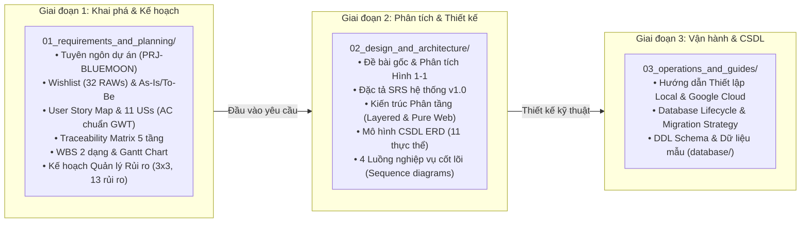

# CỔNG ĐIỀU HƯỚNG TÀI LIỆU DỰ ÁN (DOCUMENTATION MASTER HUB)
## Hệ thống Quản lý Thu phí Chung cư BlueMoon (BlueMoon BFMS)
### Học phần: Công nghệ phần mềm (IT3180) — Viện CNTT&TT (SoICT) / ĐHBK Hà Nội

---

## 1. Lộ trình Tra cứu Nhanh theo Vai trò

| Bạn là ai? | Tài liệu cần đọc trước | Mục đích |
|---|---|---|
| **Giảng viên chấm bài** | 1. [Tuyên ngôn dự án](./01_requirements_and_planning/03_tuyen_ngon_du_an.md) 2. [User Story & Acceptance Criteria](./01_requirements_and_planning/05_chi_tiet_us_va_acceptance_criteria.md) 3. [Kế hoạch WBS & Gantt Chart](./01_requirements_and_planning/09_ke_hoach_du_an_chi_tiet.md) 4. [Quản lý Rủi ro toàn diện](./01_requirements_and_planning/10_ke_hoach_quan_ly_rui_ro_toan_dien.md) 5. [Đặc tả SRS & Kiến trúc](./02_design_and_architecture/SRS.md) | Đánh giá toàn diện 3 cột mốc: Khai phá yêu cầu, Lập kế hoạch dự án, và Phân tích thiết kế hệ thống theo chuẩn SoICT. |
| **Product Manager & BA** | 1. [Client's Wishlist & Scenarios](./01_requirements_and_planning/06_client_wishlist_as_is_to_be_nfr.md) 2. [User Story Map](./01_requirements_and_planning/04_ke_hoach_du_an_va_user_story_map.md) 3. [Traceability Matrix](./01_requirements_and_planning/07_traceability_matrix_va_quan_ly_rui_ro.md) 4. [Phụ lục Tuân thủ Pháp lý](./01_requirements_and_planning/08_phu_luc_tuan_thu_phap_ly.md) | Quản lý phạm vi (Scope), ma trận truy vết (Traceability), giải quyết xung đột thu phí và tuân thủ Thông tư 02/2016, Nghị định 93/2021. |
| **Developer Backend & DB** | 1. [Kiến trúc Phân tầng](./02_design_and_architecture/architecture.md) 2. [Mô hình CSDL (ERD)](./02_design_and_architecture/erd.md) 3. [4 Luồng Nghiệp vụ Sequence](./02_design_and_architecture/workflows.md) 4. [Hướng dẫn Cài đặt & GCP](./03_operations_and_guides/local-development.md) 5. [Thư mục CSDL DDL & Data](../database/README.md) | Nắm chắc quy chuẩn phân tầng, cấu trúc bảng CSDL, luồng thực thi giao dịch ACID và cách kết nối PostgreSQL. |
| **Frontend & QA Tester** | 1. [Chi tiết AC (Given-When-Then)](./01_requirements_and_planning/05_chi_tiet_us_va_acceptance_criteria.md) 2. [4 Luồng nghiệp vụ UI](./02_design_and_architecture/workflows.md) 3. [Quy chuẩn Coding & View](../BLUEMOON.md) | Xây dựng màn hình Thymeleaf chuẩn theo Figma và thiết kế Test Cases bao phủ đường đi cơ bản (Basis Path) & Bảng quyết định. |

---

## 2. Bản đồ Cấu trúc Hồ sơ theo 3 Cột mốc Vòng đời Phần mềm (SDLC)

---

## 3. Danh mục Chi tiết Tài liệu Dự án

### 📁 [01_requirements_and_planning/](./01_requirements_and_planning/README.md) — Giai đoạn 1: Khai phá Yêu cầu & Kế hoạch Dự án
*Tập trung toàn bộ hồ sơ nghiệp vụ, kế hoạch phân công, tuyên ngôn dự án và quản lý rủi ro chuẩn Bộ môn CNPM (SoICT).*

1. [00_tong_quan_proposal.md](./01_requirements_and_planning/00_tong_quan_proposal.md): Tổng quan hồ sơ, cơ cấu tổ chức nhóm Team 13 và khung khai phá yêu cầu.
2. [01_phac_thao_va_ke_hoach_phan_cong.md](./01_requirements_and_planning/01_phac_thao_va_ke_hoach_phan_cong.md): 5 bước khai phá và bảng phân công 5 thành viên trong 6 ngày.
3. [02_ke_hoach_chi_tiet_khai_pha.md](./01_requirements_and_planning/02_ke_hoach_chi_tiet_khai_pha.md): Kế hoạch khai phá, bối cảnh tòa nhà 30 tầng, phân loại phí và 9 sản phẩm bàn giao.
4. [03_tuyen_ngon_du_an.md](./01_requirements_and_planning/03_tuyen_ngon_du_an.md): Tuyên ngôn dự án sơ khởi (`PRJ-BLUEMOON-2026`), Scope In/Out, Stakeholders, 8 mục tiêu SMART `OBJ-01` $\rightarrow$ `OBJ-08`, kịch bản phỏng vấn.
5. [04_ke_hoach_du_an_va_user_story_map.md](./01_requirements_and_planning/04_ke_hoach_du_an_va_user_story_map.md): Kế hoạch tiến độ và toàn bộ **User Story Map** 6 Epics trích xuất từ sơ đồ Google Sheet.
6. [05_chi_tiet_us_va_acceptance_criteria.md](./01_requirements_and_planning/05_chi_tiet_us_va_acceptance_criteria.md): Chi tiết 11 User Stories (`US-001` $\rightarrow$ `US-011`) kèm toàn bộ Acceptance Criteria chuẩn **Given-When-Then** và DoD.
7. [06_client_wishlist_as_is_to_be_nfr.md](./01_requirements_and_planning/06_client_wishlist_as_is_to_be_nfr.md): 32 mong muốn thô (`RAW-001` $\rightarrow$ `RAW-032`), As-Is Scenario Map & 5 Pain Points, To-Be Scenario Map và 5 NFRs định lượng.
8. [07_traceability_matrix_va_quan_ly_rui_ro.md](./01_requirements_and_planning/07_traceability_matrix_va_quan_ly_rui_ro.md): Ma trận truy vết 5 tầng, biên bản giải quyết xung đột thu phí và nhật ký rủi ro ban đầu.
9. [08_phu_luc_tuan_thu_phap_ly.md](./01_requirements_and_planning/08_phu_luc_tuan_thu_phap_ly.md): Phụ lục tuân thủ Luật Cư trú 2020, Thông tư 02/2016/TT-BXD, Nghị định 93/2021/NĐ-CP và Nghị định 13/2023 về bảo vệ dữ liệu cá nhân.
10. [09_ke_hoach_du_an_chi_tiet.md](./01_requirements_and_planning/09_ke_hoach_du_an_chi_tiet.md): **[Chuẩn SoICT Bài 4.2]** Cấu trúc phân cấp công việc WBS 2 dạng (theo Sản phẩm & theo Scrum 4 Sprints), Ma trận RACI và Biểu đồ Gantt Chart.
11. [10_ke_hoach_quan_ly_rui_ro_toan_dien.md](./01_requirements_and_planning/10_ke_hoach_quan_ly_rui_ro_toan_dien.md): **[Chuẩn SoICT Bài 4.3]** Thang đo Bảng 4-2/4-3, Ma trận $3 \times 3$, Bảng 4-1 mở rộng 13 rủi ro chi tiết kèm hành động ngăn ngừa và Risk Tracking Log.

---

### 📁 [02_design_and_architecture/](./02_design_and_architecture/README.md) — Giai đoạn 2: Phân tích & Thiết kế Hệ thống
*Tập trung các tài liệu kỹ thuật, mô hình hóa dữ liệu, kiến trúc phân tầng và luồng tương tác hệ thống.*

1. [DE_BAI_GOC.md](./02_design_and_architecture/DE_BAI_GOC.md): Toàn văn đề bài gốc môn học và phân tích ảnh chụp mẫu phiếu thu viết tay Hình 1-1.
2. [SRS.md](./02_design_and_architecture/SRS.md): Tài liệu Đặc tả Yêu cầu Phần mềm (Software Requirements Specification) tổng quan.
3. [architecture.md](./02_design_and_architecture/architecture.md): Tài liệu Thiết kế Kiến trúc Hệ thống (Pure Web & Layered Architecture Controller $\rightarrow$ Service $\rightarrow$ Repository $\rightarrow$ Entity).
4. [erd.md](./02_design_and_architecture/erd.md): Mô hình Thực thể Liên kết (Entity-Relationship Diagram) gồm 11 bảng và từ điển dữ liệu.
5. [workflows.md](./02_design_and_architecture/workflows.md): Sơ đồ và kịch bản chi tiết **4 luồng nghiệp vụ cốt lõi** (Đăng ký tài khoản, Cấu hình khoản thu, Thu phí & xuất biên lai, Báo cáo thống kê).

---

### 📁 [03_operations_and_guides/](./03_operations_and_guides/README.md) — Giai đoạn 3: Vận hành, Môi trường & CSDL
*Tập trung hướng dẫn phát triển cục bộ, cấu hình cloud và quản lý vòng đời cơ sở dữ liệu.*

1. [local-development.md](./03_operations_and_guides/local-development.md): Hướng dẫn thiết lập môi trường phát triển (Java 25 LTS, Maven Wrapper), kết nối PostgreSQL Google Cloud Console, Docker Compose và chạy kiểm thử tự động với H2.
2. [database/README.md](../database/README.md): Hướng dẫn vòng đời CSDL (Database Lifecycle), quy trình đồng bộ giữa Dev và Staging Cloud.
3. [database/schema.sql](../database/schema.sql): Script DDL khởi tạo toàn bộ cấu trúc bảng và chỉ mục.
4. [database/seed_data.sql](../database/seed_data.sql): Dữ liệu khởi tạo mẫu phục vụ dev và demo đồ án.

---

## 4. Hướng dẫn Truy vết Định danh Kỹ thuật (Traceability Index)

Mọi thành phần trong mã nguồn và kiểm thử đều được truy vết trực tiếp về các mã định danh chuẩn:
- **Client's Wish List (Yêu cầu thô):** `RAW-001` $\rightarrow$ `RAW-032` (Chi tiết tại [`06_client_wishlist_as_is_to_be_nfr.md`](./01_requirements_and_planning/06_client_wishlist_as_is_to_be_nfr.md))
- **Mục tiêu SMART:** `OBJ-01` $\rightarrow$ `OBJ-08` (Chi tiết tại [`03_tuyen_ngon_du_an.md`](./01_requirements_and_planning/03_tuyen_ngon_du_an.md))
- **User Stories & Acceptance Criteria:** `US-001` $\rightarrow$ `US-011` (Chi tiết tại [`05_chi_tiet_us_va_acceptance_criteria.md`](./01_requirements_and_planning/05_chi_tiet_us_va_acceptance_criteria.md))
- **Yêu cầu Phi chức năng:** `NFR-01` $\rightarrow$ `NFR-05` (Chi tiết tại [`06_client_wishlist_as_is_to_be_nfr.md`](./01_requirements_and_planning/06_client_wishlist_as_is_to_be_nfr.md))
- **Rủi ro Dự án:** `RSK-01` $\rightarrow$ `RSK-13` (Chi tiết tại [`10_ke_hoach_quan_ly_rui_ro_toan_dien.md`](./01_requirements_and_planning/10_ke_hoach_quan_ly_rui_ro_toan_dien.md))
