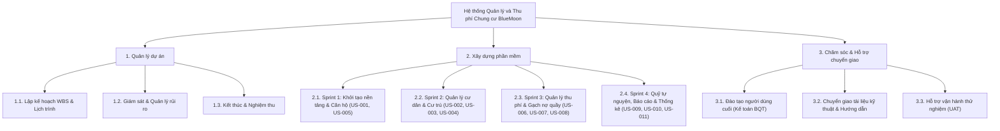
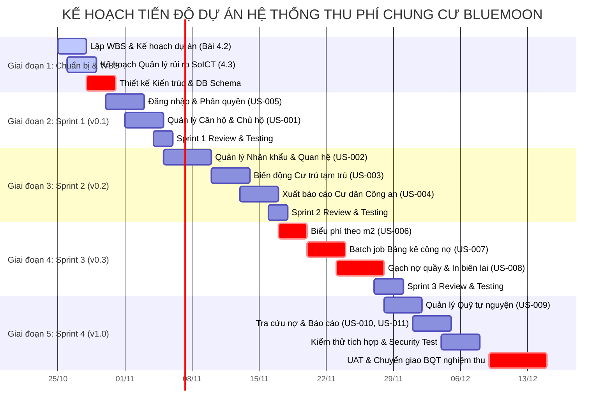

# BÀI 4.2: KẾ HOẠCH DỰ ÁN & CẤU TRÚC PHÂN CẤP CÔNG VIỆC (WBS)
## HỆ THỐNG QUẢN LÝ THU PHÍ CHUNG CƯ BLUEMOON (BLUEMOON BMS)

> **Mã dự án:** `PRJ-BLUEMOON-2026`  
> **Học phần:** IT3180 - Nhập môn Công nghệ Phần mềm | Bộ môn CNPM - Trường CNTT&TT - ĐHBK Hà Nội  
> **Nhóm thực hiện:** Nhóm 13 (Team 13)  
> **Phiên bản tài liệu:** v1.1 | Ngày cập nhật: 25/10/2026  
> **Căn cứ hướng dẫn:** **Bài 4.2 Lập kế hoạch dự án** trong `Huong dan xay dung Ke hoach du an.pdf` & Mẫu WBS chuẩn `Mau_cau_truc_phan_chia_cong_viec.xlsx`.  
> *(Lưu ý: Phần Khởi tạo dự án - Bài 4.1 đã được nhóm hoàn thiện độc lập tại tài liệu [`docs/proposal/03_tuyen_ngon_du_an.md`](./03_tuyen_ngon_du_an.md)).*

---

## 1. MỤC TIÊU VÀ NGUYÊN TẮC LẬP KẾ HOẠCH DỰ ÁN

### 1.1. Mục tiêu (Theo Bài 4.2 của Bộ môn CNPM)
- Phân rã các chức năng đã xác định trong hồ sơ yêu cầu (11 User Stories từ `US-001` đến `US-011`) thành các nhiệm vụ cụ thể (task) để xây dựng kế hoạch dự án phần mềm hoàn chỉnh.
- Thiết lập cấu trúc phân chia công việc (**WBS - Work Breakdown Structure**) theo cả 2 hình thức hướng dẫn của thầy:
  1. *Phân chia theo sản phẩm bàn giao (Deliverable-oriented WBS - Hình 4-1)*.
  2. *Phân chia theo quy trình Scrum (Process-oriented WBS - Hình 4-3)*.
- Phân công trách nhiệm minh bạch cho 5 thành viên nhóm (**Khánh, Hoà, Đức Anh, Sơn, Huy**) thông qua **Ma trận RACI**.
- Trực quan hóa tiến độ và sự phụ thuộc giữa các công việc bằng **Biểu đồ Gantt Chart**.

### 1.2. Tuân thủ Quy tắc 100% (The 100% Rule)
Quy tắc 100% là nguyên tắc cốt lõi trong tài liệu hướng dẫn của bộ môn:
> *"Tổng khối lượng các gói công việc cấp dưới phải bao quát chính xác 100% công việc của gói cấp trên, không thiếu sót và không dư thừa. Khi hoàn thành hết các gói công việc lớp dưới, gói công việc lớp trên cũng hoàn thành."*

Kế hoạch này đảm bảo 100% phạm vi phần mềm quản lý thu phí chung cư BlueMoon (3 module chính: Quản lý thu phí, Quản lý hộ gia đình, Quản lý người dùng) được hiện thực hóa trọn vẹn trong 8 tuần phát triển.

---

## 2. CẤU TRÚC PHÂN CẤP CÔNG VIỆC THEO SẢN PHẨM BÀN GIAO (DELIVERABLE-ORIENTED WBS)

Bảng phân chia công việc chi tiết tuân thủ chính xác bố cục các cột trong file mẫu `Mau_cau_truc_phan_chia_cong_viec.xlsx` từ thư mục tham chiếu của bộ môn:

| Level | Mã WBS | Mô tả công việc (Task Description) | Người phụ trách | Ngày bắt đầu | Ngày kết thúc | Ghi chú & Sản phẩm đầu ra | Chi phí (VNĐ) |
| :---: | :--- | :--- | :---: | :---: | :---: | :--- | :---: |
| **0** | **BMS** | **HỆ THỐNG QUẢN LÝ THU PHÍ CHUNG CƯ BLUEMOON** | **Team 13** | **20/10/2026** | **15/12/2026** | **Hệ thống phần mềm hoàn chỉnh v1.0** | **36.500.000** |
| 1 | 1.0 | Quản lý dự án (Project Management) | Khánh | 20/10/2026 | 15/12/2026 | Kế hoạch WBS, Risk Log, Báo cáo tiến độ | 4.500.000 |
| 2 | 1.1 | Lập kế hoạch phân rã công việc WBS & Lịch trình | Khánh, Hoà | 25/10/2026 | 28/10/2026 | Bảng WBS & Biểu đồ Gantt Chart | 1.500.000 |
| 2 | 1.2 | Lập kế hoạch quản lý rủi ro toàn diện (Bài 4.3) | Khánh, Huy | 26/10/2026 | 29/10/2026 | Ma trận rủi ro 3x3 & Risk Tracking Log | 1.000.000 |
| 2 | 1.3 | Điều phối Scrum, kiểm soát phạm vi & họp Sprint | Khánh | 30/10/2026 | 15/12/2026 | Biên bản họp Daily Standup & Review | 2.000.000 |
| 1 | 2.0 | Module Quản lý Cư dân & Hộ gia đình | Sơn, Hoà | 28/10/2026 | 18/11/2026 | Phân hệ dữ liệu cư dân BlueMoon | 10.000.000 |
| 2 | 2.1 | Quản lý căn hộ và thông tin chủ hộ (`US-001`) | Sơn | 28/10/2026 | 04/11/2026 | API/UI căn hộ, diện tích $m^2$, chủ hộ | 2.500.000 |
| 2 | 2.2 | Quản lý thành viên nhân khẩu & quan hệ (`US-002`) | Sơn | 05/11/2026 | 11/11/2026 | CRUD nhân khẩu, quan hệ nhân thân | 2.500.000 |
| 2 | 2.3 | Quản lý biến động cư trú tạm trú/tạm vắng (`US-003`) | Hoà, Sơn | 12/11/2026 | 18/11/2026 | Quản lý hồ sơ cư trú có thời hạn | 2.500.000 |
| 2 | 2.4 | Xuất danh sách nhân khẩu báo cáo công an (`US-004`) | Đức Anh | 12/11/2026 | 18/11/2026 | Xuất file Excel/PDF chuẩn cơ quan | 2.500.000 |
| 1 | 3.0 | Module Quản lý Thu phí & Đóng góp | Hoà, Sơn | 12/11/2026 | 02/12/2026 | Phân hệ lõi tài chính và công nợ | 12.000.000 |
| 2 | 3.1 | Thiết lập danh mục & biểu phí theo $m^2$ (`US-006`) | Hoà | 12/11/2026 | 18/11/2026 | Cấu hình định mức phí DV & phí QL | 2.500.000 |
| 2 | 3.2 | Tự động tạo bảng kê công nợ tháng (`US-007`) | Hoà, Sơn | 19/11/2026 | 25/11/2026 | Batch job phát sinh công nợ tự động | 3.000.000 |
| 2 | 3.3 | Thu tiền tại quầy, gạch nợ & in biên lai (`US-008`) | Sơn, Đức Anh | 19/11/2026 | 25/11/2026 | Giao dịch gạch nợ ACID, mẫu in biên lai | 3.500.000 |
| 2 | 3.4 | Quản lý các chiến dịch quỹ tự nguyện (`US-009`) | Hoà | 26/11/2026 | 02/12/2026 | Khởi tạo chiến dịch & đóng góp tùy tâm | 1.500.000 |
| 2 | 3.5 | Tra cứu công nợ & Lập báo cáo tài chính (`US-010`, `US-011`) | Hoà, Đức Anh | 26/11/2026 | 02/12/2026 | Dashboard thống kê, danh sách hộ nợ | 1.500.000 |
| 1 | 4.0 | Module Quản trị Người dùng & Hệ thống | Đức Anh, Hoà | 28/10/2026 | 09/11/2026 | Phân hệ bảo mật & người dùng | 5.000.000 |
| 2 | 4.1 | Xác thực đăng nhập & Phân quyền BQT/Kế toán (`US-005`) | Hoà | 28/10/2026 | 04/11/2026 | Security filter, Session, Phân quyền RBAC | 2.500.000 |
| 2 | 4.2 | Quản lý tài khoản, đổi mật khẩu & Audit log | Đức Anh | 05/11/2026 | 09/11/2026 | Quản lý hồ sơ cá nhân, nhật ký hệ thống | 2.500.000 |
| 1 | 5.0 | Đảm bảo chất lượng & Chuyển giao sản phẩm | Huy, Khánh | 20/10/2026 | 15/12/2026 | Bộ hồ sơ nghiệm thu và kiểm thử | 5.000.000 |
| 2 | 5.1 | Lập kế hoạch & thiết kế ca kiểm thử (Test Cases) | Huy | 05/11/2026 | 25/11/2026 | Tài liệu Test Plan, 85+ Test cases chi tiết | 2.000.000 |
| 2 | 5.2 | Thực hiện kiểm thử chức năng, tích hợp & bảo mật | Huy | 26/11/2026 | 06/12/2026 | Báo cáo kiểm thử (Test Summary Report) | 1.500.000 |
| 2 | 5.3 | Soạn tài liệu Hướng dẫn sử dụng & Cài đặt | Đức Anh, Khánh | 03/12/2026 | 09/12/2026 | File User_Guide.pdf & Install_Guide.pdf | 1.000.000 |
| 2 | 5.4 | Triển khai thử nghiệm (UAT) & Bàn giao nghiệm thu | Khánh, Huy | 10/12/2026 | 15/12/2026 | Biên bản nghiệm thu BQT ký xác nhận | 500.000 |

---

## 3. CẤU TRÚC WBS THEO QUY TRÌNH SCRUM (PROCESS-ORIENTED WBS)

Theo mô hình phát triển phần mềm lặp Agile/Scrum (Hình 4-3 trong tài liệu của bộ môn), cấu trúc phân cấp gồm 3 nhóm chính: **1. Quản lý dự án**, **2. Xây dựng phần mềm** (phân bổ qua 4 Sprint), và **3. Chăm sóc hỗ trợ**:

### Chi tiết phân rã nhiệm vụ và sản phẩm bàn giao 4 Sprint:

#### Sprint 1 (20/10 - 02/11/2026): Khởi tạo Nền tảng, Phân quyền & Quản lý Căn hộ
- **Mục tiêu Sprint:** Thiết lập khung kiến trúc backend/frontend, cơ chế bảo mật xác thực và phân hệ quản lý căn hộ.
- **User Stories thực hiện:**
  - `US-005`: Đăng nhập, phân quyền vai trò Ban quản trị vs Kế toán thu ngân, đổi mật khẩu.
  - `US-001`: Khởi tạo và quản lý danh mục căn hộ (tầng 6 đến 30), lưu diện tích sàn $m^2$, thông tin chủ hộ.
- **Sản phẩm bàn giao (Deliverable):** Bản dựng v0.1 có thể đăng nhập, xem Dashboard và thao tác dữ liệu căn hộ.

#### Sprint 2 (03/11 - 16/11/2026): Quản lý Cư dân, Nhân khẩu & Hồ sơ Cư trú
- **Mục tiêu Sprint:** Số hóa 100% dữ liệu cư dân, quan hệ thân nhân với chủ hộ và quản lý biến động cư trú.
- **User Stories thực hiện:**
  - `US-002`: Quản lý danh sách nhân khẩu theo từng căn hộ, liên kết quan hệ thân nhân (vợ/chồng, con, bố mẹ...).
  - `US-003`: Ghi nhận biến động cư trú có thời hạn: Thường trú, Tạm trú, Tạm vắng (chuẩn Luật Cư trú 2020).
  - `US-004`: Xuất danh sách nhân khẩu báo cáo Công an phường và Tổ dân phố.
- **Sản phẩm bàn giao (Deliverable):** Bản dựng v0.2 quản lý trọn vẹn thông tin hộ cư dân, kết xuất báo cáo Excel danh sách cư trú.

#### Sprint 3 (17/11 - 30/11/2026): Định mức Biểu phí $m^2$, Lập Bảng kê & Gạch nợ tại Quầy
- **Mục tiêu Sprint:** Xây dựng lõi nghiệp vụ thu phí bắt buộc, tự động hóa tính toán công nợ và chức năng thu ngân.
- **User Stories thực hiện:**
  - `US-006`: Cấu hình danh mục và đơn giá phí dịch vụ ($2.500 - 16.500$ đ/$m^2$) và phí quản lý ($\ge 7.000$ đ/$m^2$).
  - `US-007`: Batch job tự động phát sinh bảng kê công nợ hàng tháng cho $100\%$ các căn hộ theo diện tích.
  - `US-008`: Quầy thu tiền kế toán: tra cứu căn hộ, gạch nợ giao dịch ACID và in biên lai thu tiền chi tiết.
- **Sản phẩm bàn giao (Deliverable):** Bản dựng v0.3 phân hệ tài chính cốt lõi, chạy thông suốt luồng tạo nợ và gạch nợ quầy.

#### Sprint 4 (01/12 - 15/12/2026): Quỹ Tự nguyện, Báo cáo Tài chính, Kiểm thử & Bàn giao
- **Mục tiêu Sprint:** Hoàn thiện mảng vận động tự nguyện, tra cứu công nợ, kiểm thử toàn diện và bàn giao nghiệm thu.
- **User Stories thực hiện:**
  - `US-009`: Quản lý các chiến dịch vận động đóng góp quỹ tự nguyện (khuyến học, người nghèo, biển đảo), ghi nhận ủng hộ tùy tâm.
  - `US-010`: Tra cứu công nợ theo căn hộ/chủ hộ, lịch sử nộp tiền.
  - `US-011`: Dashboard tổng hợp báo cáo thu nộp định kỳ và danh sách các hộ còn nợ phí.
- **Sản phẩm bàn giao (Deliverable):** Hệ thống BlueMoon BMS v1.0 hoàn chỉnh, bộ tài liệu HDSD và Biên bản nghiệm thu BQT ký xác nhận.

---

## 4. MA TRẬN PHÂN CÔNG TRÁCH NHIỆM (RACI MATRIX)

Ma trận RACI phân định rõ vai trò và trách nhiệm của **5 thành viên nhóm 13** đối với từng gói công việc:

*Quy ước:*
- **R (Responsible):** Người trực tiếp thực hiện công việc.
- **A (Accountable):** Người chịu trách nhiệm phê duyệt cuối cùng về chất lượng công việc (duy nhất 1 người).
- **C (Consulted):** Người được tham vấn ý kiến chuyên môn.
- **I (Informed):** Người được cập nhật tiến độ và kết quả công việc.

| Gói công việc / Sản phẩm bàn giao | Khánh (PM/BA) | Hoà (Tech Lead) | Đức Anh (Frontend) | Sơn (Database) | Huy (QA/Test) |
| :--- | :---: | :---: | :---: | :---: | :---: |
| **1.1 Lập WBS, Phân rã Task & Tiến độ** | **A / R** | C | I | I | C |
| **1.2 Lập Kế hoạch Quản lý Rủi ro SoICT** | **A / R** | C | I | I | C |
| **2.1 Thiết kế Kiến trúc hệ thống & DB Schema (ERD)** | C | **A** | I | **R** | I |
| **2.2 Thiết kế UI/UX Wireframe & Master Layout** | C | I | **A / R** | I | I |
| **3.1 Sprint 1: Auth & Quản lý Căn hộ (`US-001`, `005`)** | A | C | R | R | C |
| **3.2 Sprint 2: Quản lý Cư dân & Cư trú (`US-002`, `003`, `004`)** | A | C | R | R | C |
| **3.3 Sprint 3: Quản lý Thu phí & Gạch nợ (`US-006`, `007`, `008`)** | A | R | R | R | C |
| **3.4 Sprint 4: Quỹ tự nguyện & Báo cáo (`US-009`, `010`, `011`)** | A | R | R | C | C |
| **4.1 Lập Test Plan & Thiết kế Test Cases** | C | I | I | I | **A / R** |
| **4.2 Kiểm thử tích hợp, kiểm thử hiệu năng & bảo mật** | I | C | C | C | **A / R** |
| **5.1 Soạn tài liệu Hướng dẫn sử dụng & Cài đặt** | A | C | **R** | C | I |
| **5.2 Tổ chức kiểm thử chấp nhận người dùng (UAT) & Nghiệm thu** | **A / R** | C | I | I | C |

---

## 5. BIỂU ĐỒ TIẾN ĐỘ DỰ ÁN (GANTT CHART)

Biểu đồ Gantt Chart trực quan hóa toàn bộ tiến độ 8 tuần triển khai dự án từ 20/10/2026 đến 15/12/2026 bằng cú pháp **Mermaid**:

