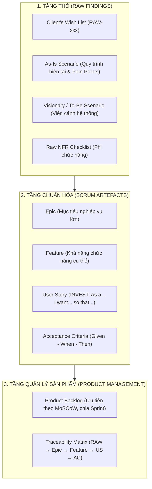

# KẾ HOẠCH KHAI PHÁ YÊU CẦU (REQUIREMENT ELICITATION PLAN)
## Dự án: Hệ thống Quản lý Thu phí Chung cư BlueMoon

---

## 1. Mục tiêu và Phạm vi dự án

### 1.1. Mục tiêu tổng thể
Xây dựng kế hoạch và thực thi quy trình khai phá yêu cầu một cách bài bản, khoa học theo tiêu chuẩn Kỹ nghệ phần mềm hiện đại (Scrum / Agile):
1. Thu thập yêu cầu từ cả nguồn con người (Ban quản trị, Kế toán/Thủ quỹ, cư dân, tổ dân phố) và nguồn phi con người (biên lai giấy, sổ hộ khẩu, file Excel, quy chuẩn pháp luật hiện hành).
2. Phát hiện và làm rõ các nhu cầu tiềm ẩn (hidden requirements), khoảng trống nghiệp vụ và các rủi ro vận hành.
3. Ghi nhận kết quả thô có cấu trúc dưới dạng: **Client's Wish List**, **Kịch bản hiện trạng (As-Is Scenario)** và **Kịch bản viễn cảnh tương lai (Visionary/To-Be Scenario)**.
4. Chuẩn hóa kết quả thô thành các Scrum Artefacts: **Epic**, **Feature**, **User Story (chuẩn INVEST)**, **Acceptance Criteria (chuẩn Given-When-Then)** và **Product Backlog**.
5. Thiết lập bảng ma trận truy vết yêu cầu (**Traceability Matrix**) đảm bảo mọi yêu cầu đều đo lường được, kiểm thử được và truy vết xuyên suốt vòng đời phát triển.

### 1.2. Phạm vi hệ thống
- **Phạm vi trọng tâm (Phiên bản v1.0):**
  - Quản lý hộ gia đình (sổ hộ khẩu) và cư dân (nhân khẩu), lịch sử biến động cư dân (tạm trú, tạm vắng).
  - Quản lý danh mục các khoản thu phí định kỳ (phí dịch vụ, phí quản lý) và các khoản đóng góp tự nguyện.
  - Quản lý thu nộp tiền từ các hộ gia đình, gạch nợ, phát hành biên lai.
  - Tra cứu, tìm kiếm đa tiêu chí và báo cáo thống kê thu chi, tiến độ đóng tiền.
  - Phân quyền bảo mật tài khoản người dùng, đổi mật khẩu và quản trị hệ thống.
- **Phạm vi gợi mở (Roadmap Phiên bản v2.0):**
  - Quản lý định mức và thu phí gửi xe (xe máy, ô tô) theo thông tin phương tiện đã đăng ký.
  - Thu hộ chi phí điện, nước, cước viễn thông/internet từ các đối tác cung cấp dịch vụ.
  - Cổng dịch vụ trực tuyến dành cho cư dân (Resident Portal).

---

## 2. Ý nghĩa và Cấu trúc phân tầng các tài liệu Elicitation

Hệ thống tài liệu yêu cầu được tổ chức theo 3 tầng chuẩn tắc:

| Tầng (Level) | Tài liệu (Document) | Định nghĩa (Definition) | Vai trò trong Backlog & Khai phá |
|---|---|---|---|
| **Lớp thô (Raw findings)** | **As-Is Scenario** | Kịch bản mô tả hiện trạng công việc đang diễn ra hôm nay, kèm các khó khăn/sai sót. | Làm cơ sở đối chiếu (baseline) để tìm ra khoảng trống (gap) và điểm đau (pain points). |
| **Lớp thô (Raw findings)** | **Client Wish List** | Danh sách mong muốn thô của các bên liên quan, thu thập nguyên văn, chưa lọc, chưa xếp ưu tiên. | Đầu vào cốt lõi cho việc phân tích và khai phá yêu cầu chi tiết. |
| **Lớp thô (Raw findings)** | **Visionary Scenario** | Kịch bản viễn cảnh tương lai mô tả hệ thống mới sẽ hỗ trợ công việc vận hành ra sao. | Cầu nối giữa danh sách mong muốn thô với các Scrum Artefacts chuẩn mực. |
| **Lớp chuẩn hóa (Scrum Artefacts)** | **Epic** | Nhóm yêu cầu nghiệp vụ cấp cao, đại diện cho một mục tiêu kinh doanh lớn. | Định hướng lộ trình sản phẩm (Roadmap) và kế hoạch phát hành phiên bản. |
| **Lớp chuẩn hóa (Scrum Artefacts)** | **Feature** | Một năng lực chức năng chuyên biệt trực thuộc Epic để giải quyết bài toán người dùng. | Tổ chức nhóm các User Stories, phục vụ lập kế hoạch Release. |
| **Lớp chuẩn hóa (Scrum Artefacts)** | **User Story** | Đơn vị nhỏ nhất của nhu cầu người dùng, có thể triển khai và kiểm thử trong 1 Sprint. | Lập kế hoạch Sprint (Sprint Planning), kiểm thử và nghiệm thu phát triển. |
| **Lớp chuẩn hóa (Scrum Artefacts)** | **Acceptance Criteria (AC)** | Điều kiện nghiệm thu chấp nhận câu chuyện người dùng (viết theo GWT hoặc Checklist). | Đảm bảo tính kiểm thử (Testable) và là tiêu chuẩn để QA/PO duyệt Story. |
| **Lớp quản lý sản phẩm** | **Product Backlog** | Danh sách toàn bộ User Stories/Epics đã được sắp xếp ưu tiên theo khung MoSCoW. | Điều phối phát triển, bàn giao theo từng Sprint và Release. |
| **Lớp quản lý sản phẩm** | **Traceability Matrix** | Bảng ma trận ánh xạ liên kết đa chiều xuyên suốt chuỗi yêu cầu phần mềm. | Đảm bảo không bỏ sót bất kỳ mong muốn nào của khách hàng (Traceability $\ge 80\%$). |

---

## 3. Bộ Mục tiêu Khai phá Yêu cầu (SMART Objectives)

Theo tiêu chuẩn đề bài, dự án thiết lập 8 mục tiêu cụ thể, đo lường được:

| Mã ID | Mục tiêu (SMART Objective) | Chỉ số đo / Minh chứng cụ thể | Nguồn đo kiểm | Hạn chót | Artefact đầu ra |
|:---:|---|---|---|:---:|---|
| **OBJ-01** | Thu thập $\ge 80\%$ yêu cầu chức năng cho BlueMoon v1.0 (quản lý cư dân, danh mục khoản thu, thu phí, tra cứu/thống kê, xác thực người dùng). | $\ge 30$ yêu cầu thô được ghi nhận trong danh sách | Biên bản phỏng vấn, khảo sát cư dân, phân tích mẫu Excel/biên lai | D+7 | **Client's Wish List** |
| **OBJ-02** | Xác định $\ge 5$ yêu cầu phi chức năng thiết yếu (bảo mật dữ liệu, phân quyền, sao lưu, hiệu năng tải, nhật ký audit log...). | $\ge 5$ mục NFR được đặc tả rõ ràng với tiêu chí đo | Bảng Checklist NFR, tiêu chuẩn an toàn bảo mật | D+7 | **Acceptance Criteria / DoD / NFR Log** |
| **OBJ-03** | Ghi nhận và mô tả hiện trạng quy trình thu phí và quản lý cư dân thủ công qua sổ sách/Excel. | $\ge 1$ tài liệu kịch bản As-Is hoàn chỉnh, có bảng phân tích Pain Points | Biên bản quan sát thực địa, ảnh chụp mẫu giấy tờ thu chi (Hình 1-1) | D+6 | **As-Is Scenario** |
| **OBJ-04** | Mô tả viễn cảnh kỳ vọng tương lai (Visionary Scenario) bao gồm nghiệp vụ v1.0 và gợi mở v2.0 (phí gửi xe, thu hộ điện/nước). | $\ge 1$ tài liệu Visionary Scenario hoàn chỉnh | Biên bản phiên làm việc (workshop) với Ban quản trị BlueMoon | D+6 | **Visionary Scenario** |
| **OBJ-05** | Chuẩn hóa toàn bộ kết quả thô thành danh mục phân cấp với $\ge 5$ Epic và $\ge 10$ Feature. | Danh mục Epic & Feature được Ban quản trị/PO phê duyệt | Bảng danh mục Epic - Feature chuẩn hóa | D+8 | **Epic & Feature List** |
| **OBJ-06** | Xây dựng $\ge 10$ User Stories theo chuẩn INVEST, đầy đủ kịch bản Acceptance Criteria theo chuẩn Given-When-Then (GWT). | $10+$ User Stories có đầy đủ AC đạt chuẩn testable | Bản thảo Product Backlog được rà soát nội bộ | D+8 | **User Story + Acceptance Criteria** |
| **OBJ-07** | Hoàn thiện Product Backlog đầy đủ, phân loại ưu tiên khoa học theo khung MoSCoW (Must / Should / Could / Won't). | Toàn bộ Backlog được gán nhãn ưu tiên và chia Sprint dự kiến | Biên bản thống nhất Backlog với Product Owner | D+8 | **Product Backlog** |
| **OBJ-08** | Thiết lập bảng ánh xạ ma trận truy vết đầy đủ từ Client's Wish List $\rightarrow$ Epic $\rightarrow$ Feature $\rightarrow$ User Story $\rightarrow$ AC. | $\ge 80\%$ yêu cầu thô được truy vết liên tục đến tận cấp độ AC | Bảng ma trận Traceability Matrix | D+8 | **Traceability Matrix** |

---

## 4. Ma trận Kỹ thuật Khai phá Yêu cầu (Elicitation Matrix)

| Kỹ thuật Elicitation | Nguồn thông tin (Stakeholders/Sources) | Mục tiêu thu thập | Artefact Scrum đầu ra |
|---|---|---|---|
| **Phỏng vấn bán cấu trúc (Semi-structured Interview)** | Trưởng Ban quản trị chung cư BlueMoon | Nắm bắt quy trình quản lý cư dân, khó khăn khi dùng Excel, yêu cầu bảo mật, phân quyền và trách nhiệm giải trình. | Client's Wish List, As-Is Scenario, Visionary Scenario |
| **Quan sát công việc thực tế (Job Observation)** | Kế toán, Thủ quỹ tòa nhà | Quan sát thao tác tra cứu cư dân khi thu phí, ghi nhận thời gian tính toán diện tích $\times$ đơn giá, phát hành biên lai giấy, các sai sót thường gặp. | As-Is Scenario, Client's Wish List |
| **Phỏng vấn / Khảo sát nhanh (Survey / Short Interview)** | Chủ hộ đại diện, cư dân chung cư BlueMoon | Nhu cầu minh bạch các khoản đóng góp, mong muốn xem lịch sử đóng tiền, hình thức thanh toán thuận tiện, giảm phiền hà. | Client's Wish List, Visionary Scenario |
| **Phỏng vấn chuyên gia & Tra cứu quy định pháp lý** | Tổ trưởng tổ dân phố, Cán bộ Công an khu vực | Yêu cầu pháp lý về khai báo cư trú (Luật Cư trú), quy trình báo cáo tạm trú/tạm vắng, các trường dữ liệu hộ khẩu bắt buộc. | Acceptance Criteria, As-Is Scenario, NFR Checklist |
| **Phân tích tài liệu & hiện vật (Document Analysis)** | Mẫu sổ thu quỹ (Hình 1-1), bảng tính Excel quản lý cư dân | Bóc tách cấu trúc dữ liệu hiện tại, các cột thông tin, lỗi định dạng, việc thiếu nhật ký thay đổi và các hạn chế của biểu mẫu giấy. | As-Is Scenario, Data Dictionary |
| **Workshop đồng bộ (Joint Workshop)** | Ban quản trị + Đội ngũ kỹ sư khai phá yêu cầu | Thống nhất phạm vi v1.0, làm rõ các khoản phí bắt buộc vs tự nguyện, định hình roadmap cho phiên bản v2.0. | Visionary Scenario, Epic, Feature |
| **Refinement Session (Tinh chỉnh yêu cầu)** | Ban quản trị (PO) + Nhóm phát triển phần mềm | Chuyển hóa mong muốn thô thành User Stories chuẩn INVEST, xây dựng kịch bản kiểm thử Acceptance Criteria (GWT). | User Stories, Acceptance Criteria, Product Backlog |

---

## 5. Kịch bản Phỏng vấn Mẫu (Interview Script)

Kịch bản phỏng vấn được thiết kế chuẩn mực gồm 8 phần nhằm thu thập tối đa thông tin từ các bên liên quan:

### 5.1. Giới thiệu (Introduction)
- **Lời chào & mục đích:** *"Xin chào anh/chị. Cảm ơn anh/chị đã dành thời gian tham gia buổi phỏng vấn hôm nay. Chúng tôi đang thực hiện phân tích và thiết kế Phần mềm Quản lý Thu phí và Dân cư Chung cư BlueMoon nhằm giúp tối ưu hóa công tác thu nộp phí và quản lý cư dân của tòa nhà."*
- **Quy tắc làm việc:** Cam kết bảo mật thông tin phỏng vấn, thời gian dự kiến 45 phút, ghi chép và ghi âm (nếu được đồng ý).

### 5.2. Ngữ cảnh & Hiện trạng (Context / As-Is)
- *Câu hỏi cho Kế toán/Thủ quỹ:* "Hàng tháng, anh/chị thực hiện tính toán và thu các loại phí dịch vụ, phí quản lý như thế nào? Quy trình từ lúc lập thông báo đến khi thu đủ tiền diễn ra trong bao lâu?"
- *Câu hỏi cho Ban quản trị:* "Hiện nay việc lưu trữ thông tin các hộ dân, nhân khẩu và các biến động như chuyển đến, chuyển đi, tạm vắng/tạm trú được theo dõi trên công cụ gì?"

### 5.3. Khó khăn & Điểm đau (Pain Points)
- "Những phiền toái hoặc rủi ro lớn nhất mà anh/chị gặp phải khi sử dụng sổ tay viết tay hoặc file Excel là gì?"
- "Đã từng có trường hợp thất lạc dữ liệu, tính nhầm tiền theo diện tích, hoặc cư dân thắc mắc về số tiền đóng góp các quỹ từ thiện chưa? Khi đó xử lý như thế nào?"
- "Việc tổng hợp danh sách cư dân tạm trú, tạm vắng để nộp cho Công an phường mất bao nhiêu thời gian?"

### 5.4. Mong muốn & Nhu cầu (Wishlist / Needs)
- "Nếu có một phần mềm mới, tính năng nào anh/chị mong muốn có đầu tiên để giảm nhẹ áp lực công việc hàng ngày?"
- "Anh/chị cần những trường thông tin cụ thể nào đối với một nhân khẩu và một khoản thu phí?"

### 5.5. Viễn cảnh kỳ vọng (Vision / To-Be)
- "Anh/chị hình dung một ngày làm việc lý tưởng khi có phần mềm sẽ như thế nào? Ví dụ: Khi một cư dân đến nộp tiền, hệ thống sẽ hỗ trợ anh/chị những bước gì?"
- "Về định hướng tương lai, tòa nhà có kế hoạch thu phí gửi xe ô tô/xe máy hoặc thu hộ tiền điện, nước thông qua phần mềm hay không?"

### 5.6. Yêu cầu phi chức năng & Ràng buộc (Non-Functional / Constraints)
- "Anh/chị có yêu cầu gì về vấn đề bảo mật tài khoản, quyền hạn giữa kế toán và trưởng ban quản trị?"
- "Dữ liệu thu nộp và thông tin cư dân cần được sao lưu định kỳ ra sao để tránh mất mát?"
- "Tốc độ phản hồi của phần mềm khi tra cứu hàng nghìn cư dân và hàng chục căn hộ cần đáp ứng ở mức độ nào?"

### 5.7. Xếp hạng ưu tiên (Prioritization)
- "Trong các nhóm chức năng: Quản lý hộ khẩu/nhân khẩu, Tính phí dịch vụ định kỳ, Quản lý các quỹ từ thiện, Tra cứu/báo cáo — nhóm nào là bắt buộc phải có ngay trong phiên bản đầu tiên (v1.0)?"

### 5.8. Tổng kết & Mở rộng (Closing)
- "Còn vấn đề hoặc yêu cầu đặc thù nào của chung cư BlueMoon mà chúng tôi chưa đề cập tới nhưng anh/chị thấy rất quan trọng không?"
- *"Rất cảm ơn anh/chị. Chúng tôi sẽ tổng hợp các nội dung này thành tài liệu phân tích nghiệp vụ và gửi lại anh/chị đối soát trong phiên làm việc tiếp theo."*
