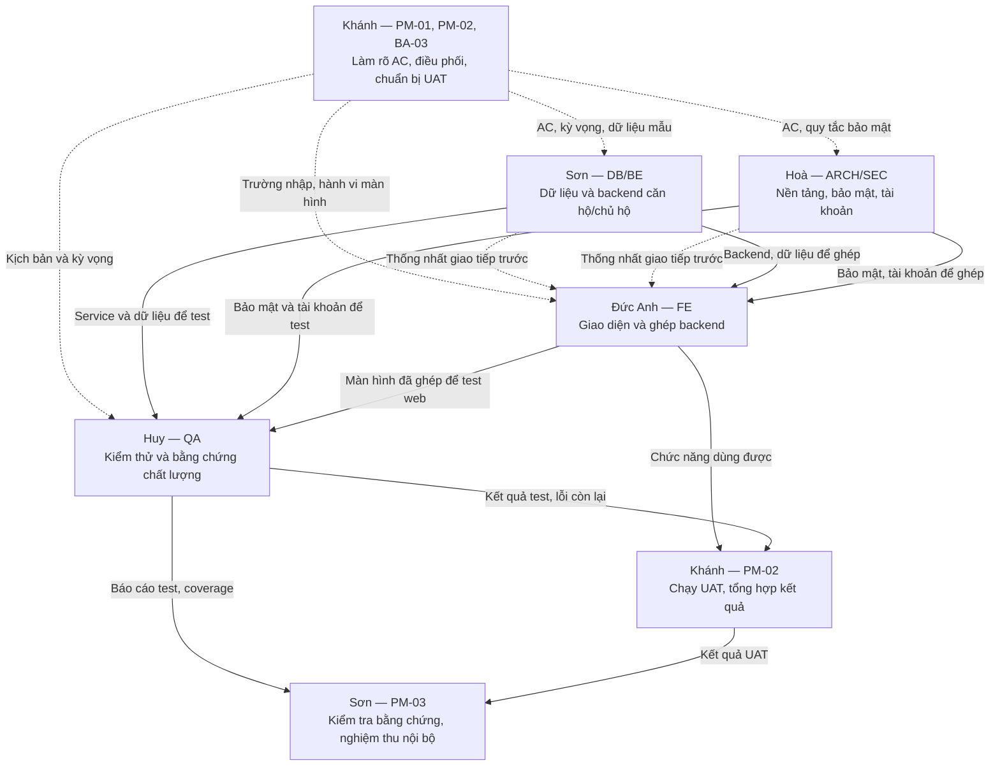
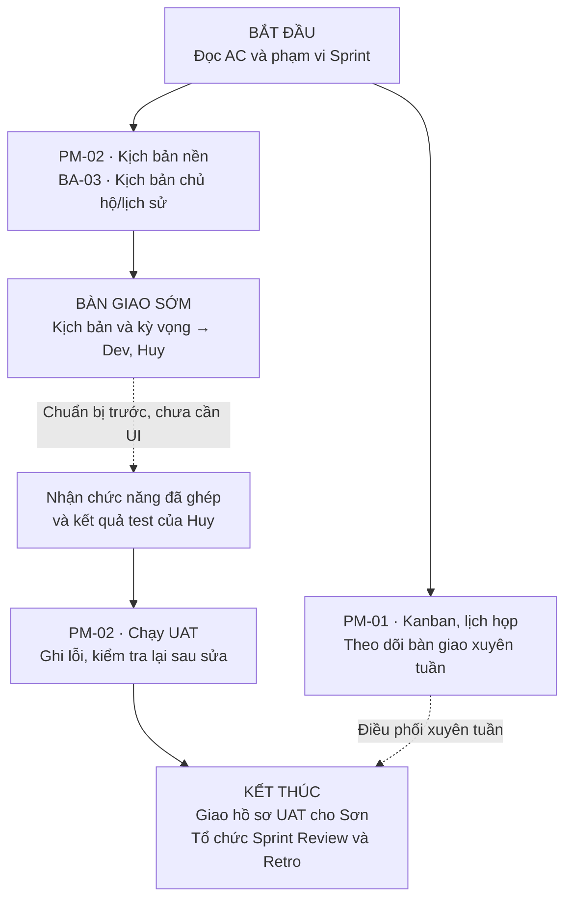
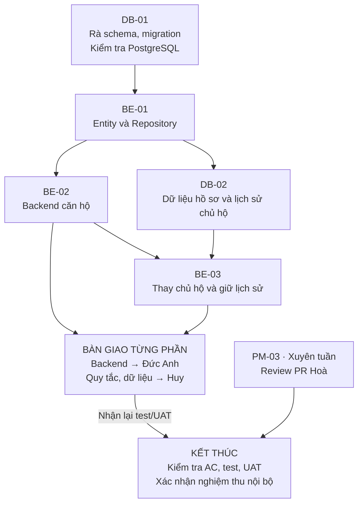
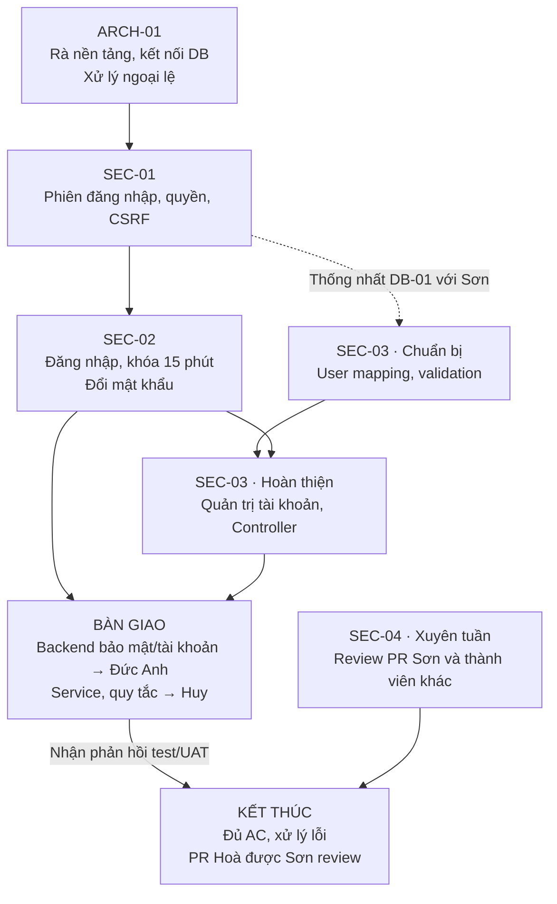
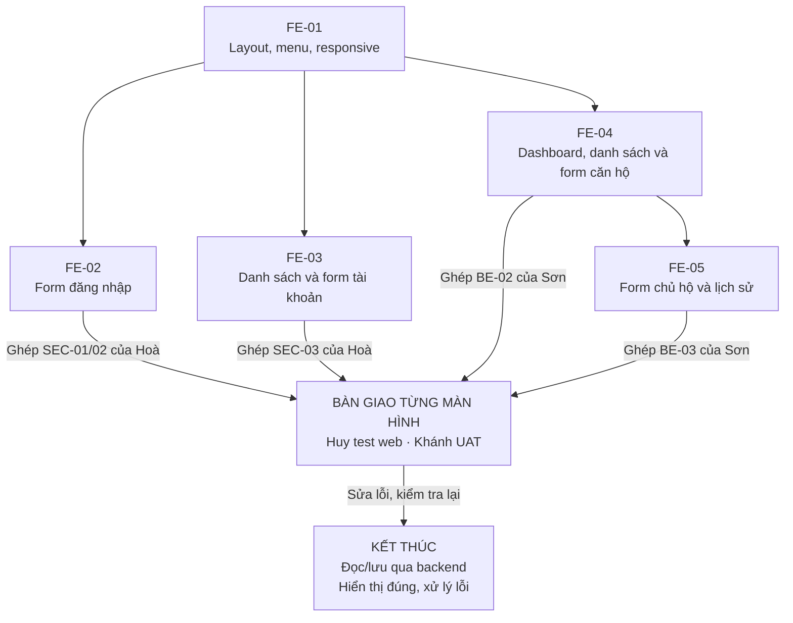
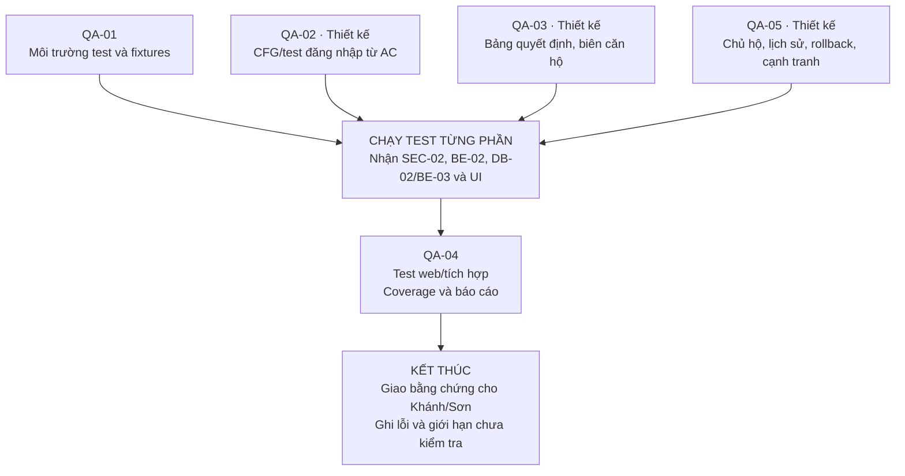

# Luồng công việc Sprint 1

Cập nhật 01/11/2026 · Sprint 31/10–06/11/2026.

Đọc đồ thị chung trước, sau đó mở luồng của mình. Các đồ thị biểu diễn **kế hoạch và bàn giao**, không xác nhận chức năng đã hoàn thành. Mũi tên liền: cần sản phẩm để tiếp tục; nét đứt: trao đổi hoặc chuẩn bị song song. Không dùng thứ tự hiển thị để suy ra ngày nhận việc.

Nguồn quyết định: [quy chuẩn](../../PROJECT_CONVENTIONS.md). Phạm vi: [US/AC](../../01_requirements_and_planning/05_chi_tiet_us_va_acceptance_criteria.md). Chi tiết giao việc: [backlog 24 gói / 44 phần việc](github_issues_backlog.md#work-units). Các số Issue trong backlog là số đề xuất nội bộ, chưa phải ID GitHub.

## 1. Bàn giao toàn nhóm

Khánh theo dõi đầu vào/đầu ra và trở ngại; Sơn/Hoà/Đức Anh chịu trách nhiệm nội dung kỹ thuật. Trước khi phát triển song song, thống nhất URL/method, tên trường form/DTO, dữ liệu trả về, lỗi, quyền/CSRF và dữ liệu giả để kiểm tra. Đây là những nội dung **cần chốt**, chưa phải hợp đồng kỹ thuật đã được đặc tả đầy đủ.

Mỗi người tự cập nhật task và báo vướng cho Khánh. Vướng kỹ thuật chuyển Sơn/Hoà; đổi phạm vi/ưu tiên do Sơn chốt sau trao đổi nhóm. Khi test/UAT phát hiện lỗi, người thực hiện sửa và bàn giao lại để kiểm tra; các đồ thị dưới đây lược bỏ vòng sửa lỗi cho dễ đọc.

## 2. Khánh — điều phối / BA / UAT (22h, 6 SP)

| Bước | Cần nhận / bàn giao | Điều kiện xong và tài liệu |
|---|---|---|
| PM-01 | Nhận cập nhật của cả nhóm; bàn giao Kanban, lịch họp, phụ thuộc và biên bản | Task có người phụ trách, theo dõi trở ngại, có Review/Retro; [AC PM-01](github_issues_backlog.md#pm-01) |
| PM-02: chuẩn bị; BA-03 | Nhận AC; giao kịch bản, dữ liệu giả và kỳ vọng cho Dev/Huy ngay từ đầu | Kịch bản nền và chủ hộ có AC, bước làm, kỳ vọng; [PM-02](github_issues_backlog.md#pm-02), [BA-03](github_issues_backlog.md#ba-03) |
| PM-02: thực thi | Nhận chức năng đã ghép từ Dev và kết quả test của Huy; giao lỗi cho Dev, hồ sơ UAT cho Sơn | Có kết quả thực chạy, lỗi và kiểm tra lại; không ghi khách hàng đã ký khi chưa có bằng chứng |

Khánh tổ chức Sprint Review; người triển khai demo. Khánh tổng hợp hồ sơ, Sơn xác nhận nghiệm thu nội bộ. Cẩm nang: [Khánh](TV1_Khanh_PO_BA.md).

## 3. Sơn — trưởng nhóm / DB / Backend (36h, 10 SP)

| Bước | Cần nhận / bàn giao | Điều kiện xong và tài liệu |
|---|---|---|
| DB-01 | Nhận [schema](../../../database/schema.sql); giao migration đã kiểm tra cho Hoà/Huy và BE-01 | Chạy trên PostgreSQL, có kết quả ràng buộc/seed; [DB-01 — AC](github_issues_backlog.md#db-01) |
| BE-01 | Nhận DB-01; giao Entity/Repository và cách dùng cho Hoà/Huy | Mapping, kiểu dữ liệu, query được kiểm tra; [BE-01 — AC](github_issues_backlog.md#be-01) |
| BE-02 | Nhận BE-01; giao backend căn hộ cho Đức Anh/Huy | Chặn mã trùng, diện tích sai, tầng/loại sai; giao dịch đúng, test đạt; [BE-02 — AC](github_issues_backlog.md#be-02) |
| DB-02 | Nhận DB-01/BE-01; giao DDL/ERD hồ sơ và lịch sử cho BE-03/Huy | CCCD duy nhất, tối đa một hộ ACTIVE, không mất hồ sơ cũ; [DB-02 — AC](github_issues_backlog.md#db-02) |
| BE-03 | Nhận BE-02/DB-02; giao xử lý chủ hộ/lịch sử cho Đức Anh/Huy | Validate hồ sơ, giữ lịch sử, giao dịch rollback khi lỗi; [BE-03 — AC](github_issues_backlog.md#be-03) |
| PM-03 | Nhận PR Hoà, test từ Huy, hồ sơ UAT từ Khánh | Review không tự duyệt; đủ AC/test/UAT và quality gate mới nghiệm thu; [PM-03 — AC](github_issues_backlog.md#pm-03) |

Tra cứu: [backlog DB/BE và AC](github_issues_backlog.md), [cẩm nang Sơn](TV2_Son_Database_Backend.md), [US-001](../../01_requirements_and_planning/05_chi_tiet_us_va_acceptance_criteria.md#us-001-quản-lý-thông-tin-căn-hộ-và-chủ-hộ). Sơn không làm lại báo cáo test/UAT và không vận hành daily/Kanban.

## 4. Hoà — nền tảng / bảo mật / tài khoản (28h, 8 SP)

| Bước | Cần nhận / bàn giao | Điều kiện xong và tài liệu |
|---|---|---|
| ARCH-01 | Nhận cấu hình nền tảng hiện có; giao khung chạy được cho FE/QA/SEC | Build, PostgreSQL và xử lý ngoại lệ được kiểm tra theo AC; [ARCH-01 — AC](github_issues_backlog.md#arch-01) |
| SEC-01 | Nhận ARCH-01; thống nhất form/URL/quyền với Đức Anh, bàn giao cấu hình cho Huy | Route, phiên, CSRF, BCrypt đúng AC; [SEC-01 — AC](github_issues_backlog.md#sec-01) |
| SEC-02 | Nhận SEC-01; giao đăng nhập/đổi mật khẩu cho Đức Anh, hành vi/Clock cho Huy | Sai lần 5 khóa 15 phút; reset đúng; tài khoản vô hiệu hóa bị chặn; [SEC-02 — AC](github_issues_backlog.md#sec-02) và US-SEC-02 |
| SEC-03 | Nhận DB-01/SEC-01 để chuẩn bị; ghép sau SEC-02; giao quản trị tài khoản cho Đức Anh/Huy | Username/email duy nhất, quyền, tạo và đổi trạng thái đúng; [SEC-03 — AC](github_issues_backlog.md#sec-03) |
| SEC-04 | Nhận PR Sơn; PR khác do Sơn hoặc Hoà review | Kiểm tra kiến trúc, truy vết, test/CI; PR Hoà do Sơn duyệt; [SEC-04 — AC](github_issues_backlog.md#sec-04) |

Tra cứu: [backlog ARCH/SEC](github_issues_backlog.md), [quy tắc đăng nhập](../../PROJECT_CONVENTIONS.md#đăng-nhập--us-sec-02--nfr-02), [cẩm nang Hoà](TV3_Hoa_TechLead_Security.md). UI dùng lỗi chung, không tiết lộ trạng thái khóa; nội dung cũ mâu thuẫn trong checklist FE-02 phải đọc theo quy chuẩn hiện hành.

## 5. Đức Anh — giao diện và ghép backend (28h, 7 SP)

| Bước | Cần nhận / bàn giao | Điều kiện xong và tài liệu |
|---|---|---|
| FE-01 | Nhận khung templates/ARCH-01; giao layout dùng chung cho các form | Header/sidebar/footer, thông tin vai trò, responsive; [FE-01 — AC](github_issues_backlog.md#fe-01) |
| FE-02 | Thống nhất SEC-01; ghép đăng nhập với Hoà; giao màn hình cho Huy/Khánh | Form hoạt động, CSRF hợp lệ, lỗi chung tiếng Việt; [FE-02 — AC](github_issues_backlog.md#fe-02) và quy chuẩn |
| FE-03 | Nhận thỏa thuận và backend SEC-03; giao màn hình tài khoản cho Huy/Khánh | Danh sách/tạo/đổi trạng thái và form liên quan hoạt động; [FE-03 — AC](github_issues_backlog.md#fe-03), bảng phần việc |
| FE-04 | Nhận thỏa thuận và backend BE-02; giao màn hình căn hộ cho Huy/Khánh | Danh sách, bộ lọc, form, lỗi phía server hoạt động; [FE-04 — AC](github_issues_backlog.md#fe-04) |
| FE-05 | Nhận FE-04 và thỏa thuận BE-03; ghép sau BE-03; giao chủ hộ/lịch sử cho Huy/Khánh | Lưu hợp lệ, chặn sai phía server, hiện lịch sử, kiểm tra trình duyệt; [FE-05 — AC](github_issues_backlog.md#fe-05) |

Tra cứu: [backlog FE](github_issues_backlog.md), [cẩm nang Đức Anh](TV4_DucAnh_Frontend_UI.md). Dựng form với dữ liệu giả sau khi thống nhất giao tiếp; chưa ghép backend và kiểm tra thực tế thì chưa Done.

## 6. Huy — thiết kế sớm, chạy theo từng bàn giao (24h, 5 SP)

| Bước | Cần nhận / bàn giao | Điều kiện xong và tài liệu |
|---|---|---|
| QA-01 | Nhận nền tảng ARCH-01, phối hợp Dev về dữ liệu; giao fixtures dùng chung | Test độc lập, dữ liệu giả sẵn sàng; [QA-01 — AC](github_issues_backlog.md#qa-01) |
| QA-02 | Thiết kế từ AC; chạy sau SEC-02/QA-01; giao lỗi cho Hoà | CFG khớp mã cuối cùng, đủ nhánh và biên khóa; [QA-02 — AC](github_issues_backlog.md#qa-02) |
| QA-03 | Thiết kế từ AC; chạy sau BE-02/QA-01; giao lỗi cho Sơn | Bảng quyết định và test tham số hóa đạt kỳ vọng; [QA-03 — AC](github_issues_backlog.md#qa-03) |
| QA-05 | Soạn sớm; chạy sau DB-02/BE-03/FE-05/QA-01; giao lỗi cho Sơn/Đức Anh | Hồ sơ, lịch sử, rollback, cạnh tranh trên PostgreSQL và web được kiểm tra; [QA-05 — AC](github_issues_backlog.md#qa-05) |
| QA-04 | Nhận backend/UI tương ứng; giao báo cáo cho Khánh/Sơn | Test tích hợp, coverage Service + Controller ≥85%, ghi kết quả thực chạy và giới hạn; [QA-04 — AC](github_issues_backlog.md#qa-04) |

Tra cứu: [backlog QA](github_issues_backlog.md), [thiết kế kiểm thử](kiem_thu_hoc_thuat_cfg_decision_table.md), [cẩm nang Huy](TV5_Huy_QA_Automation.md). H2 smoke test chỉ chứng minh khởi động; ràng buộc/migration/rollback/cạnh tranh cần bằng chứng PostgreSQL phù hợp.

## 7. Bắt đầu và kết thúc Sprint

| Người | Nhận việc đầu tiên | Tổng ước lượng |
|---|---|---:|
| Khánh | PM-01: Kanban/lịch họp (3h); chuẩn bị PM-02/BA-03 song song theo khả năng | 22h / 6 SP |
| Sơn | DB-01: review schema/migration (3h) | 36h / 10 SP |
| Hoà | ARCH-01: rà cấu hình/build nền tảng (2h) | 28h / 8 SP |
| Đức Anh | FE-01: layout/nav (3h), sau khi xác nhận khung ARCH-01 | 28h / 7 SP |
| Huy | QA-01: fixtures/nền tảng test (4h); thiết kế ca từ AC ngay | 24h / 5 SP |
| **Tổng** | **24 gói / 44 phần việc 2–4h; chưa xác nhận đủ năng lực thực tế** | **138h / 36 SP** |

Mỗi lần nhận việc, nói rõ: **nhận gì từ ai → làm phần việc nào → giao gì cho ai → bằng chứng nào chứng minh xong**. Không đợi xong cả gói lớn mới bàn giao phần dùng được.

Sơn và Hoà review chéo xuyên tuần, không tự duyệt. Huy cung cấp test/coverage; Khánh cung cấp UAT và tổ chức Review/Retro. Sơn xác nhận nghiệm thu khi đủ AC, test, UAT và `clean verify -Psprint1-quality` theo [quy chuẩn kiểm tra](../../PROJECT_CONVENTIONS.md#build-ci-và-coverage). CI nền tảng xanh không phải bằng chứng hoàn thành Sprint; task thiếu bằng chứng tiếp tục mở.

Các báo cáo UAT/test được nhắc trong backlog là **sản phẩm cần tạo**; không suy ra đã có hoặc đã ký. Tài liệu này hướng dẫn đọc luồng, không thay thế AC/backlog và không tự cập nhật tiến độ.
