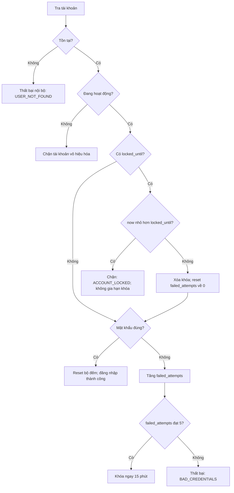

# Thiết kế kiểm thử Sprint 1 — CFG và Decision Table

Truy vết: US-SEC-02 / NFR-02; US-001 / RAW-001, RAW-002.

## 1. CFG đăng nhập — thiết kế chờ đối chiếu mã triển khai

`AuthService` chưa được triển khai. Sơ đồ dưới đây mô tả hành vi yêu cầu, không phải minh chứng coverage đã đo. Khi có mã, Huy và Hoà đánh số nút/cạnh, chốt cách tính short-circuit, tính V(G) và lập tập basis paths tương ứng. Không giữ kết luận V(G)=5 hoặc Rank=5 của bản cũ.

### 1.1. Thứ tự xử lý và CFG dự kiến

Đúng thời điểm hết hạn (`now == locked_until`) đi qua nhánh mở khóa. Một lần thử sau khi mở khóa được tính từ 0. Kết quả nội bộ không được dùng để tiết lộ username trên giao diện; UI trả thông báo thất bại chung.

### 1.2. Cách hoàn thiện chứng minh CFG

1. Lấy phương thức Java cuối cùng sau review, kể cả nhánh vô hiệu hóa và reset khóa.
2. Chuẩn hóa một điểm vào/một điểm ra của đồ thị, ghi N nút, E cạnh và tính V(G)=E−N+2 cho một đồ thị liên thông.
3. Ghi rõ điều kiện ghép có tách short-circuit thành từng nhánh hay không; dùng nhất quán khi vẽ và tính.
4. Lập basis paths độc lập theo CFG đó; gắn từng đường tới test ID. Không suy ra số đường từ số test nghiệp vụ.
5. Chạy test và ghi coverage thực tế. Chỉ đưa khẳng định hạng ma trận nếu kèm đúng ma trận, cách lập và kết quả tính có thể kiểm tra.

### 1.3. Danh mục ca kiểm thử bắt buộc

| ID | Đầu vào / trạng thái | Kỳ vọng |
|---|---|---|
| TC_LOGIN_BP_01 | Username không tồn tại | Thất bại nội bộ; UI lỗi chung |
| TC_LOGIN_BP_02 | Khóa còn hạn, kể cả mật khẩu đúng | Chặn; giữ nguyên locked_until |
| TC_LOGIN_BP_03 | Đã sai 4 lần, tiếp tục sai | Bộ đếm 5; khóa ngay now+15 phút |
| TC_LOGIN_BP_04 | Sai dưới ngưỡng | Tăng bộ đếm; chưa khóa |
| TC_LOGIN_BP_05 | Đúng mật khẩu, tài khoản hợp lệ | Thành công; bộ đếm về 0 |
| TC_LOGIN_EDGE_01 | is_active=false | Chặn cả khi mật khẩu đúng |
| TC_LOGIN_EDGE_02 | Vừa trước thời điểm hết khóa | Vẫn chặn |
| TC_LOGIN_EDGE_03 | Đúng thời điểm hết khóa, mật khẩu sai | Xóa khóa; bộ đếm mới bằng 1 |
| TC_LOGIN_EDGE_04 | Sau thời điểm hết khóa, mật khẩu đúng | Thành công; xóa khóa, bộ đếm 0 |
| TC_LOGIN_EDGE_05 | Sau thời điểm hết khóa, mật khẩu sai | Bộ đếm mới bằng 1 |
| TC_LOGIN_EDGE_06 | Đúng mật khẩu sau vài lần sai chưa khóa | Thành công; bộ đếm 0 |

Dùng `Clock` cố định/thay thế trong test; không chờ 15 phút thật. Các ID BP cũ được giữ để truy vết, chưa có nghĩa chúng là tập basis paths đầy đủ của mã cuối cùng.

---

## 2. KIỂM THỬ HỘP ĐEN: BẢNG QUYẾT ĐỊNH (DECISION TABLE) CHO QUẢN LÝ CĂN HỘ (`US-001`)

### 2.1. Phân tích Điều kiện & Hành động (SoICT Chapter 9)
- **Điều kiện đầu vào (Conditions):**
  - **C1:** Mã căn hộ (`room_number`) đã tồn tại chưa? (T / F)
  - **C2:** Số tầng có nằm trong dải thiết kế $1 \le \text{floor} \le 30$? (T / F)
  - **C3:** Diện tích thông thủy có strictly positive ($> 0\text{ m}^2$)? (T / F)
  - **C4:** Loại hình căn hộ có thuộc enum (`KIOT`, `COMMERCIAL`, `RESIDENTIAL`, `PENTHOUSE`)? (T / F)
  - **C5:** Loại hình có tương thích với số tầng tòa nhà BlueMoon? (T / F)
    * `KIOT`: Tầng 1
    * `COMMERCIAL`: Tầng 2–5
    * `RESIDENTIAL`: Tầng 6–29
    * `PENTHOUSE`: Tầng 30
- **Hành động hệ thống (Actions):**
  - **A1:** Lưu bản ghi căn hộ thành công vào CSDL.
  - **A2:** Báo lỗi trùng mã căn (`DuplicateRoomException`).
  - **A3:** Báo lỗi số tầng ngoài dải $1 \le \text{floor} \le 30$.
  - **A4:** Báo lỗi diện tích thông thủy phải lớn hơn 0.
  - **A5:** Báo lỗi loại hình căn hộ không hợp lệ.
  - **A6:** Báo lỗi xung đột loại hình với số tầng thiết kế.

---

### 2.2. Bảng Quyết định Kiểm thử Toàn diện (6 Rules)

| Quy tắc (Rule) | R1 | R2 | R3 | R4 | R5 | R6 |
|---|:---:|:---:|:---:|:---:|:---:|:---:|
| **Điều kiện C1 (Trùng mã phòng?)** | **True** | False | False | False | False | False |
| **Điều kiện C2 (Số tầng $1 \le \text{floor} \le 30$?)** | - | **False** (`< 1` hoặc `> 30`) | True | True | True | **True** |
| **Điều kiện C3 (Diện tích $m^2 > 0$?)** | - | - | **False** (`\le 0`) | True | True | **True** |
| **Điều kiện C4 (Loại hình hợp lệ?)** | - | - | - | **False** | True | **True** |
| **Điều kiện C5 (Tương thích Tầng & Loại hình?)** | - | - | - | - | **False** | **True** |
| **Hành động A1 (Lưu thành công CSDL)** | | | | | | **X** |
| **Hành động A2 (Báo lỗi Trùng mã căn)** | **X** | | | | | |
| **Hành động A3 (Báo lỗi Số tầng sai)** | | **X** | | | | |
| **Hành động A4 (Báo lỗi Diện tích $\le 0$)** | | | **X** | | | |
| **Hành động A5 (Báo lỗi Sai loại hình)** | | | | **X** | | |
| **Hành động A6 (Báo lỗi Xung đột Tầng & Loại hình)** | | | | | **X** | |

---

### 2.3. Bộ Ca Kiểm thử Tham số hóa Tương ứng (`ApartmentServiceTest.java`)
1. `TC_APT_DT_01` (R1): Nhập `room = "P.601"` đã có trong CSDL $\rightarrow$ Báo lỗi `DuplicateRoomException`.
2. `TC_APT_DT_02a` (R2 biên dưới): Nhập `floor = 0`, `room = "P.001"` $\rightarrow$ Báo lỗi tầng $< 1$.
3. `TC_APT_DT_02b` (R2 biên trên): Nhập `floor = 31`, `room = "P.3101"` $\rightarrow$ Báo lỗi tầng $> 30$.
4. `TC_APT_DT_03a` (R3 biên 0): Nhập `area = 0.00` $\rightarrow$ Báo lỗi diện tích phải $> 0$.
5. `TC_APT_DT_03b` (R3 biên âm): Nhập `area = -75.50` $\rightarrow$ Báo lỗi diện tích phải $> 0$.
6. `TC_APT_DT_04` (R4): Nhập `type = "WAREHOUSE"` $\rightarrow$ Báo lỗi loại hình không hợp lệ.
7. `TC_APT_DT_05` (R5 xung đột): Nhập `type = "PENTHOUSE"` tại tầng 1 $\rightarrow$ Báo lỗi xung đột tầng.
8. `TC_APT_DT_06` (R6 hợp lệ): Nhập `room = "P.702"`, `floor = 7`, `area = 85.50`, `type = "RESIDENTIAL"` $\rightarrow$ Lưu thành công vào CSDL.
