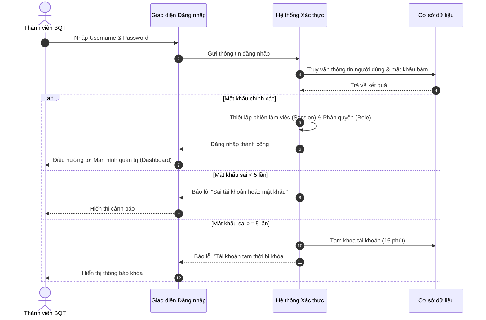
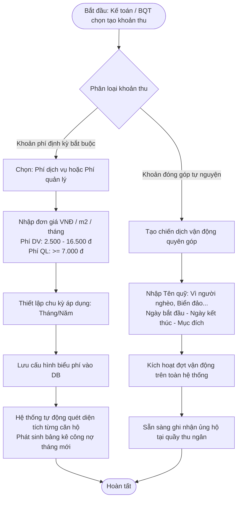
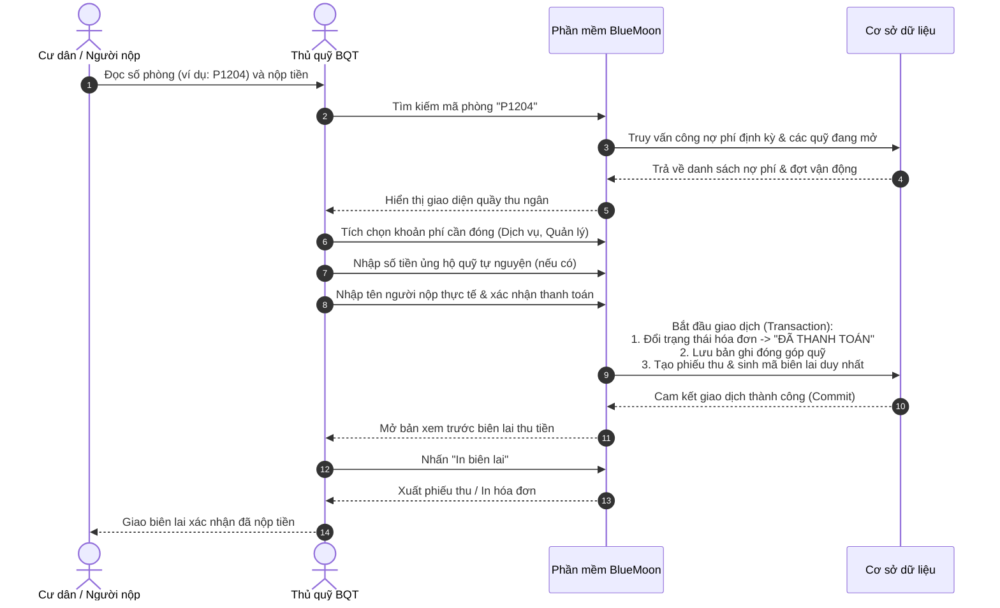
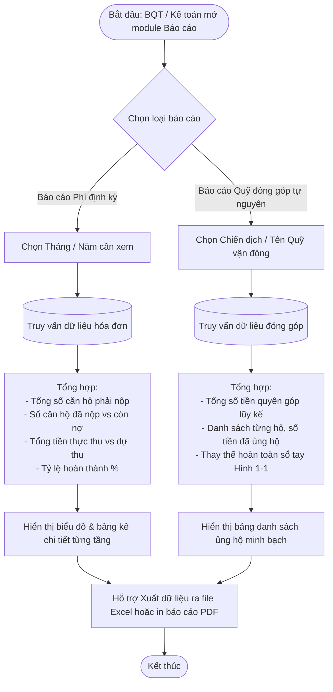

# LUỒNG NGHIỆP VỤ HỆ THỐNG (SYSTEM WORKFLOWS)
## Dự án: Hệ thống Quản lý Thu phí Chung cư BlueMoon (BlueMoon BFMS)

---

## 1. Tổng quan 4 Luồng nghiệp vụ cốt lõi

Theo yêu cầu trọng tâm của đề bài môn Công nghệ phần mềm, phiên bản v1.0 của hệ thống BlueMoon BFMS tập trung xử lý **4 luồng nghiệp vụ chính**:
1. **Luồng 1: Đăng ký & Quản lý tài khoản**
2. **Luồng 2: Tạo & Cấu hình khoản thu**
3. **Luồng 3: Thu phí & Phát hành biên lai tại quầy**
4. **Luồng 4: Thống kê & Báo cáo các khoản đóng góp và thu phí**

---

## 2. Chi tiết từng Luồng nghiệp vụ

### 2.1. Luồng 1: Đăng ký & Quản lý tài khoản (Authentication & Account Management)

- **Quy tắc nghiệp vụ:**
  - Thành viên BQT chỉ được cấp tài khoản qua Quản trị viên cấp cao (Admin).
  - Người dùng có thể chủ động truy cập trang cá nhân để đổi mật khẩu (nhập mật khẩu cũ, mật khẩu mới $\ge 8$ ký tự, xác nhận mật khẩu mới).

---

### 2.2. Luồng 2: Tạo & Cấu hình khoản thu (Fee Configuration & Campaign Creation)

---

### 2.3. Luồng 3: Thu phí & Phát hành biên lai (Payment & Receipt Issuance)

---

### 2.4. Luồng 4: Thống kê & Báo cáo các khoản đóng góp và thu phí (Reporting & Analytics)

---

## 3. Liên kết tài liệu yêu cầu chi tiết
- Để xem các kịch bản kiểm thử tương ứng cho từng luồng: [Tài liệu Scrum Artefacts & AC](./proposal/05_chi_tiet_us_va_acceptance_criteria.md).
- Để xem ma trận truy vết từ nguồn gốc yêu cầu: [Tài liệu Traceability Matrix](./proposal/07_traceability_matrix_va_quan_ly_rui_ro.md).
